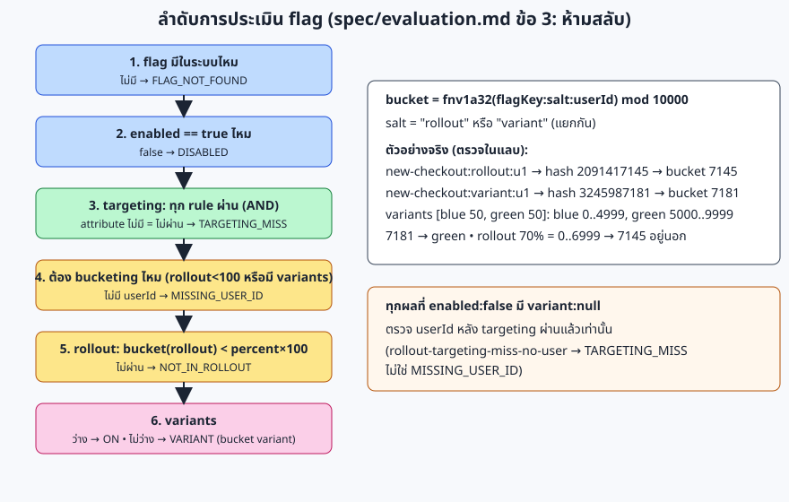
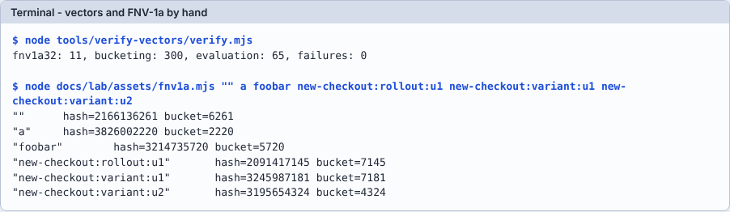

# Module 01: อ่านสเปกและ test vectors

**เป้าหมาย:** อ่านกติกา BR-xx และลำดับการประเมินให้เป็น, คำนวณ hash/bucket (FNV-1a) ด้วยโค้ดที่คุณรันเอง แล้วเห็นว่าตัวเลขตรงกับ `tests/vectors/` ทุกแถว
**เวลา:** ประมาณ 30 นาที · **ระดับ:** ง่าย · **ค่าใช้จ่าย:** 0 บาท, รันในเครื่อง · **ใช้ AI:** prompt อ่านสเปก (ไม่บังคับ)
**ก่อนหน้า:** [Module 00](00-setup.md) · **ถัดไป:** [Module 02](02-run-go-contract.md)



## ค่าที่ใช้ในแลบ

ทุกค่าด้านล่างคำนวณด้วย `docs/lab/assets/fnv1a.mjs` และตรวจกับ `tests/vectors/` แล้ว:

| input ที่ hash | hash (uint32) | bucket (mod 10000) | มาจาก |
|---|---|---|---|
| `""` (ว่าง) | 2166136261 | 6261 | `fnv1a32.json` (offset basis) |
| `a` | 3826002220 | 2220 | `fnv1a32.json` |
| `foobar` | 3214735720 | 5720 | `fnv1a32.json` |
| `new-checkout:rollout:alice` | 3449471093 | 1093 | `bucketing.json` แถวแรก |
| `new-checkout:rollout:ผู้ใช้-1` | 1899751408 | 1408 | `bucketing.json` (userId ภาษาไทย) |
| `rollout-flag:rollout:edge-5516` | 1394700999 | 999 | `evaluation.json` id `rollout-10-boundary-in` |
| `checkout-button:variant:v-50920` | 1061645000 | 5000 | `evaluation.json` id `variant-bucket-5000` |
| `new-checkout:rollout:u1` | 2091417145 | 7145 | ใช้ใน module 02 |
| `new-checkout:variant:u1` | 3245987181 | 7181 | ใช้ใน module 02 |
| `new-checkout:variant:u2` | 3195654324 | 4324 | ใช้ใน module 02 |

## Prerequisites

[Module 00](00-setup.md) (ต้องมีแค่ Node และรีโป ไม่ต้องรัน server)

## ขั้นตอน

**1. ดูว่าสเปกมีอะไร**

```bash
ls spec
```

Expected output:

```text
business-rules.md
evaluation.md
openapi.yaml
```

**2. นับกติกา BR-xx**

```bash
grep -c '^| BR-' spec/business-rules.md
```

Expected output:

```text
38
```

**3. อ่านสองกติกาตัวอย่าง**

```bash
grep -E '^\| BR-(01|31) ' spec/business-rules.md
```

Expected output:

```text
| BR-01 | `key` ต้องตรงกับ `^[a-z0-9][a-z0-9_-]{0,63}$` (ไม่ส่งมา/ไม่ใช่ string = `VALIDATION_ERROR`) | 400 `INVALID_KEY` |
| BR-31 | ผลรวม `weight` ของ variants ต้องเท่ากับ 100 | 400 `INVALID_VARIANTS` |
```

> **Tip:** อ่านคอลัมน์ที่สามก่อน: มันบอกสิ่งที่ test กลางตรวจจริง (status code และ `error.code` เท่านั้น ไม่ตรวจข้อความ `message`)

**4. อ่านลำดับการประเมินใน `spec/evaluation.md` ข้อ 3, 4.1, 4.2, 5, 6** (รูปด้านบนสรุปไว้แล้ว) แล้วลองตอบก่อนดูเฉลย: "ถ้า flag มี rule `country == TH`, `rolloutPercent = 10`, และ request ไม่มี `userId` ผลคืออะไร ถ้า request มี country = US แต่ไม่มี userId ล่ะ"

<details>
<summary>เฉลย</summary>

ไม่มี `userId` และ country = TH: `MISSING_USER_ID` (ต้อง bucketing แต่ไม่มี userId ตรวจหลัง targeting ผ่าน) ถ้า country = US: `TARGETING_MISS` เพราะ targeting มาก่อน (vector `rollout-targeting-miss-no-user` และ `rollout-targeting-hit-no-user`)

</details>

**5. ให้ตัวตรวจอิสระของ Node ตรวจ vectors ทั้งหมด**

```bash
node tools/verify-vectors/verify.mjs
```

Expected output:

```text
fnv1a32: 11, bucketing: 300, evaluation: 65, failures: 0
```

> `tests/vectors/README.md` เขียนว่า `evaluation.json` มี 57 แถว แต่คำสั่งนี้นับได้ 65 (เพิ่มภายหลัง): ถ้าตัวเลขเอกสารกับคำสั่งไม่ตรงกัน ให้เชื่อคำสั่ง และแจ้งเจ้าของเอกสาร

**6. คำนวณ FNV-1a เอง**

ไฟล์ `docs/lab/assets/fnv1a.mjs` เขียนไว้ 15 บรรทัดตาม `spec/evaluation.md` ข้อ 4.1 (`Math.imul` + `>>> 0` + แปลง string เป็น UTF-8 byte): เปิดอ่านก่อนรัน

```bash
node docs/lab/assets/fnv1a.mjs "" a foobar new-checkout:rollout:u1 new-checkout:variant:u1 new-checkout:variant:u2
```

Expected output (คั่นด้วย tab):

```text
""	hash=2166136261	bucket=6261
"a"	hash=3826002220	bucket=2220
"foobar"	hash=3214735720	bucket=5720
"new-checkout:rollout:u1"	hash=2091417145	bucket=7145
"new-checkout:variant:u1"	hash=3245987181	bucket=7181
"new-checkout:variant:u2"	hash=3195654324	bucket=4324
```



**7. เทียบกับ vectors**

```bash
node -e 'const b=require("./tests/vectors/bucketing.json").cases; console.log(JSON.stringify(b[0]))'
```

Expected output:

```text
{"flagKey":"new-checkout","salt":"rollout","userId":"alice","input":"new-checkout:rollout:alice","hash":3449471093,"bucket":1093}
```

```bash
node docs/lab/assets/fnv1a.mjs "new-checkout:rollout:alice" "new-checkout:rollout:ผู้ใช้-1" "checkout-button:variant:v-50920" "rollout-flag:rollout:edge-5516"
```

Expected output:

```text
"new-checkout:rollout:alice"	hash=3449471093	bucket=1093
"new-checkout:rollout:ผู้ใช้-1"	hash=1899751408	bucket=1408
"checkout-button:variant:v-50920"	hash=1061645000	bucket=5000
"rollout-flag:rollout:edge-5516"	hash=1394700999	bucket=999
```

สองแถวสุดท้ายคือ `debug.variantBucket = 5000` (แถวแรกของ green ในตัวอย่าง `[blue 50, green 30, red 20]`) และ `debug.rolloutBucket = 999` (bucket สุดท้ายที่ยังอยู่ใน rollout 10%) ของ vector `variant-bucket-5000` กับ `rollout-10-boundary-in`: เป็นการยืนยันว่าคุณคำนวณขอบเขตได้ตรงกับ vector เอง

**8. ลองทำให้ผิดเพื่อเห็นกับดัก (ไม่บังคับ)** แก้สำเนาไฟล์ในโฟลเดอร์ชั่วคราว: เปลี่ยน `Math.imul(h, 0x01000193) >>> 0` เป็น `(h * 0x01000193) >>> 0`

```bash
sed 's/Math.imul(h, 0x01000193) >>> 0/(h * 0x01000193) >>> 0/' docs/lab/assets/fnv1a.mjs > "$LAB/fnv-wrong.mjs"
```

```bash
node "$LAB/fnv-wrong.mjs" foobar a new-checkout:rollout:alice
```

Expected output: `a` ยังถูก (ตัวอักษรเดียวคูณแล้วยังไม่เกิน 2^53) แต่ `foobar` และ `new-checkout:rollout:alice` ผิด เพราะการคูณแบบ double เสียความแม่นยำเมื่อเกิน 2^53 (ตรงกับตารางกับดักของ TypeScript ใน `CONVENTIONS.md`):

```text
"foobar"	hash=249808880	bucket=8880
"a"	hash=3826002220	bucket=2220
"new-checkout:rollout:alice"	hash=563211503	bucket=1503
```

ข้อสังเกต: ตัวอย่าง `a` ผ่านทั้งที่โค้ดผิด จึงต้องมี input ยาวใน vectors (ตัวอย่าง `foobar` และ `bucketing.json` ที่มี flag key และ userId ยาว)

## Prompt สำหรับ AI: อ่านสเปกแบบ implementer

ใช้เมื่อสเปกเพิ่งถูกแก้ และก่อนเขียน test/โค้ด (ตรงกับ skill `spec-ambiguity-check`: ถ้ามี Claude Code พิมพ์ `/spec-ambiguity-check typescript` ได้เลย) ค่าในวงเล็บเหลี่ยมเปลี่ยนตามภาษาที่คุณจะแปล

```text
อ่านทุกไฟล์ใน spec/ ในฐานะ developer ที่ต้อง implement เป็น [TypeScript] และถามใครไม่ได้
รายการจุดที่ตีความได้มากกว่าหนึ่งแบบ (ทุกจุด ไม่ใช่แค่ 5 อันดับแรก) เรียงตามผลกระทบ
แต่ละจุดให้ระบุ: ข้อความที่กำกวม (ไฟล์และ BR), ความหมายที่แข่งกัน, คำตอบที่แนะนำ, และ test case เดียวที่ตัดสินได้
ต้องเช็คเรื่องเหล่านี้เสมอ: integer overflow, Unicode, missing/null/0, การเทียบชนิด, ลำดับ, ค่า default, ลำดับของ error
และเรื่องที่พลาดในทุกภาษาที่ผ่านมา: path ที่เข้ารหัส (%2F, %FF, %00, %zz, ;) framework ถอดรหัสก่อน routing หรือไม่,
method/path ที่ถือเป็น unknown route (OPTIONS, TRACE, HEAD, /error, /docs) และ body ของมัน,
request body (encoding อื่นนอกจาก UTF-8, BOM, NaN/Infinity, lone surrogate, key ซ้ำ, ซ้อนลึก, เลขยาว), header ที่ไม่ใช่ ASCII
ห้ามแก้ไฟล์ใดๆ ตอบเป็นรายการอย่างเดียว
```

**ทำไม prompt นี้ได้ผล:** (1) ให้ AI อยู่ในบทบาท "ผู้ implement ที่ถามใครไม่ได้" จึงต้องระบุสิ่งที่สเปกไม่ได้บอกแทนที่จะเดาเงียบๆ (CLAUDE.md: ห้ามเดากติกาที่สเปกไม่ได้บอก) (2) บังคับให้มี test case ที่ตัดสินได้ ทำให้ตรวจคำตอบได้ (3) รายการ path/method/body/header มาจากสิ่งที่ทำนายพลาดในทั้ง 4 ภาษา (`lessons/summary.md` ข้อ 3) (4) "ห้ามแก้ไฟล์" กันไม่ให้ AI ไปปรับสเปกเอง

**สิ่งที่ต้องตรวจจากคำตอบของ AI:**

- [ ] ทุกจุดมีไฟล์/BR อ้างอิงที่เปิดดูแล้วมีข้อความนั้นจริง (AI อ้าง BR ที่ไม่มีอยู่ได้)
- [ ] ทุกจุดมี "คำตอบที่แนะนำ" และ test case ที่ลงมือรันได้ (ไม่ใช่ "ควรทดสอบให้ดี")
- [ ] ครอบคลุมหัวข้อบังคับครบ: path ที่เข้ารหัส, unknown route, body, header
- [ ] ไม่มีจุดที่ AI "ตัดสินแทนสเปก" โดยไม่บอกว่าเป็นข้อสมมติ
- [ ] ไม่มีไฟล์ถูกแก้ (`git status` ต้องว่างนอกจาก `docs/lab/`)

**ตัวอย่างรูปแบบคำตอบ** (รูปแบบที่ skill กำหนด; เนื้อหาด้านล่างเป็นตัวอย่างประกอบ ไม่ได้บันทึกจาก AI):

```text
1. [สูง] business-rules.md BR-55: key ใน path เป็น percent-escape ที่ decode เป็น UTF-8 ไม่ได้
   - อ่านแบบ A: 404 FLAG_NOT_FOUND  - อ่านแบบ B: 400
   - แนะนำ: A (ตรงข้อความ BR-55)
   - test: GET /v1/flags/%FF ด้วย admin key -> 404 FLAG_NOT_FOUND
```

**ถ้า AI ตอบผิดแบบนี้ ให้ทำ…** (จากบทเรียนจริง)

| อาการของคำตอบ | ทำอะไร | ที่มา |
|---|---|---|
| รายการสั้นและเป็นเรื่องทั่วไป ("ควรจัดการ Unicode") ไม่มี input จริง | ตอบกลับ: "ทุกข้อต้องมี input ที่ส่งได้จริงและผลที่คาด" | spec-ambiguity-check ข้อ 3 |
| ไม่มีเรื่อง `%2F`, `OPTIONS`, `/docs` | ชี้ว่าเป็นหัวข้อบังคับ แล้วให้ทำซ้ำ: เรื่องนี้ทำนายพลาดในทุกภาษา | `lessons/python.md` (`%2F` ไม่เคยทำนาย) |
| เสนอ "แก้สเปกให้ตรงกับ framework" | ปฏิเสธ: เปลี่ยน server/routing ไม่ใช่เปลี่ยนสเปก | `CONVENTIONS.md` หัวข้อทดลอง framework |

## Checkpoint

1. ทำไม salt ของ rollout กับ variant ต้องแยกกัน?
2. ทำไมแปลงเป็น UTF-8 byte ก่อน hash แทนที่จะใช้ `charCodeAt`?
3. ตาม BR/สเปก `userId` เป็น attribute สำหรับ rule ได้ไหม?
4. bucket 999 กับ 1000 ที่ rollout 10%: อันไหนอยู่ใน rollout?

<details>
<summary>เฉลย</summary>

1. เพื่อไม่ให้ bucket ของ rollout สัมพันธ์กับ bucket ของ variant (`spec/evaluation.md` ข้อ 4.2) vector `variant-with-rollout-in` มี rolloutBucket 3083 กับ variantBucket 9567 ที่ต่างกัน
2. spec กำหนด "ไบต์ UTF-8" ไม่ใช่ UTF-16 code unit (`spec/evaluation.md` ข้อ 4.1): ค่า 1408 ของ `ผู้ใช้-1` ในตารางด้านบนได้จาก hash ไบต์ UTF-8 และตรงกับ vector; ภาษาที่ hash ด้วย code unit จะไม่ตรงในแถวภาษาไทย/emoji (ตารางกับดักใน `CONVENTIONS.md`; ผู้เขียนแลบไม่ได้ลอง `charCodeAt` จริง)
3. ไม่ได้ (evaluation.md 3.1: `userId` ไม่ใช่ attribute; vector `target-userid-is-not-attribute`)
4. 999 อยู่ใน (`bucket >= rolloutPercent*100` = 1000 จึงตกรอบ): vector `rollout-10-boundary-in` / `rollout-10-boundary-out`

</details>

## Troubleshooting

| อาการ | แก้ |
|---|---|
| `Cannot find module './tests/vectors/...'` | ต้องรันจาก root ของรีโป |
| ผล hash ของภาษาไทยไม่ตรง | ตรวจว่าไฟล์ถูกบันทึกเป็น UTF-8 และ terminal ส่ง UTF-8 (ลองด้วยแถว `ผู้ใช้-1`) |

## Clean up

```bash
rm -f "$LAB/fnv-wrong.mjs"
```
