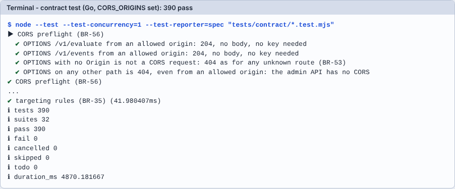

# Module 02: รัน Go ต้นฉบับและ contract test

**เป้าหมาย:** ยิง API จริงด้วย `curl` ให้เห็นทุก `reason` ของการประเมิน, รัน contract test 390 ข้อ, และอ่านผลเป็นกลุ่มตาม BR-xx
**เวลา:** ประมาณ 25 นาที (contract test ใช้ ~5 วินาทีที่วัดได้) · **ระดับ:** ง่าย · **ค่าใช้จ่าย:** 0 บาท, รันในเครื่อง · **ใช้ AI:** ไม่บังคับ (prompt สรุปผล)
**ก่อนหน้า:** [Module 01](01-spec-and-vectors.md) · **ถัดไป:** [Module 03](03-break-it.md)



## ค่าที่ใช้ในแลบ

| รายการ | ค่า |
|---|---|
| Server | Go ที่ build ใน module 00 (`$LAB/ffservice`) พอร์ต `8080` |
| Header | `X-Admin-Key: test-admin-key` (admin API) · `X-Client-Key: test-client-key` (`/v1/evaluate`, `/v1/events`) |
| `CORS_ORIGINS` | `https://app.example.com,https://b.example.com` (ต้องมี origin อย่างน้อย 2 ตัวจึงได้ test ครบ) |
| Flag ที่ใช้ | `lab-basic` (เปิด/ปิดธรรมดา), `new-checkout` (rollout + variants + rule) |
| User | `u1` → bucket 7145 (rollout) / 7181 (variant); `u2` → variant 4324; `u3` → variant 1943 (คำนวณใน module 01 แล้ว) |
| Body สร้าง flag แบบ on/off | `{"key":"lab-basic","enabled":true,"description":"my first flag"}` |
| Body สร้าง flag แบบ A/B | `{"key":"new-checkout","enabled":true,"description":"lab flag","rolloutPercent":80,"variants":[{"key":"blue","weight":50},{"key":"green","weight":50}],"rules":[{"attribute":"country","operator":"eq","value":"TH"}]}` |
| Body evaluate | `{"flags":["new-checkout"],"context":{"userId":"u1","attributes":{"country":"TH"}}}` |
| Body events | `{"events":[{"type":"exposure","flagKey":"new-checkout","userId":"u1","variant":"green","timestamp":"2026-10-31T10:00:00Z"},{"type":"conversion","goal":"purchase","userId":"u1","timestamp":"2026-10-31T10:01:00Z"}]}` |

## Prerequisites

[Module 00](00-setup.md) เสร็จแล้ว (`$LAB` ตั้งไว้ และ build `$LAB/ffservice` แล้ว)

## ขั้นตอน

**1. เปิด Go ด้วยฐานข้อมูลใหม่และเปิด CORS สำหรับ 2 origin**

```bash
( cd "$LAB/run" && ADMIN_KEY=test-admin-key CLIENT_KEY=test-client-key PORT=8080 DB_PATH="$LAB/run/flags.db" CORS_ORIGINS="https://app.example.com,https://b.example.com" exec "$LAB/ffservice" ) &
```

```bash
GO_PID=$!
```

```bash
until curl -sf localhost:8080/healthz; do sleep 0.3; done
```

Expected output: `{"status":"ok"}`

**2. สร้าง flag แบบ on/off**

```bash
curl -s -XPOST localhost:8080/v1/flags -H 'X-Admin-Key: test-admin-key' -d '{"key":"lab-basic","enabled":true,"description":"my first flag"}'
```

Expected output (เวลาต่างกันตามเครื่อง):

```text
{"key":"lab-basic","description":"my first flag","enabled":true,"rules":[],"rolloutPercent":100,"variants":[],"createdAt":"2026-10-31T11:10:00.29Z","updatedAt":"2026-10-31T11:10:00.29Z"}
```

> **Tip:** `curl -d` ส่ง `Content-Type: application/x-www-form-urlencoded` โดยปริยาย แต่ service ตอบถูกเพราะ BR-52 กำหนดให้ไม่ตรวจ Content-Type ทุกภาษาต้องรับ

**3. ประเมิน flag ที่มีอยู่และที่ไม่มี**

```bash
curl -s -XPOST localhost:8080/v1/evaluate -H 'X-Client-Key: test-client-key' -d '{"flags":["lab-basic","no-such-flag"],"context":{"userId":"u1"}}'
```

Expected output:

```text
{"results":{"lab-basic":{"enabled":true,"variant":null,"reason":"ON"},"no-such-flag":{"enabled":false,"variant":null,"reason":"FLAG_NOT_FOUND"}}}
```

**4. สร้าง flag แบบ A/B (rollout 80%, 2 variants, rule `country == TH`)**

```bash
curl -s -XPOST localhost:8080/v1/flags -H 'X-Admin-Key: test-admin-key' -d '{"key":"new-checkout","enabled":true,"description":"lab flag","rolloutPercent":80,"variants":[{"key":"blue","weight":50},{"key":"green","weight":50}],"rules":[{"attribute":"country","operator":"eq","value":"TH"}]}' -o /dev/null -w '%{http_code}\n'
```

Expected output: `201`

**5. ไล่ดูทุก `reason` ตามลำดับในรูป evaluation-order ของ module 01**

user u1, country TH: rollout bucket 7145 < 8000 (ผ่าน), variant bucket 7181 ในช่วง green (5000-9999)

```bash
curl -s -XPOST localhost:8080/v1/evaluate -H 'X-Client-Key: test-client-key' -d '{"flags":["new-checkout"],"context":{"userId":"u1","attributes":{"country":"TH"}}}'
```

Expected output:

```text
{"results":{"new-checkout":{"enabled":true,"variant":"green","reason":"VARIANT"}}}
```

country เป็น US (targeting มาก่อนทุกอย่าง):

```bash
curl -s -XPOST localhost:8080/v1/evaluate -H 'X-Client-Key: test-client-key' -d '{"flags":["new-checkout"],"context":{"userId":"u1","attributes":{"country":"US"}}}'
```

Expected output: `{"results":{"new-checkout":{"enabled":false,"variant":null,"reason":"TARGETING_MISS"}}}`

ไม่มี userId (ผ่าน targeting แต่ต้อง bucketing):

```bash
curl -s -XPOST localhost:8080/v1/evaluate -H 'X-Client-Key: test-client-key' -d '{"flags":["new-checkout"],"context":{"attributes":{"country":"TH"}}}'
```

Expected output: `{"results":{"new-checkout":{"enabled":false,"variant":null,"reason":"MISSING_USER_ID"}}}`

**6. เปลี่ยน rollout เป็น 70% (PUT เป็น full replace ต้องส่ง `key` ด้วย) แล้วดู u1 หลุด rollout**

```bash
curl -s -XPUT localhost:8080/v1/flags/new-checkout -H 'X-Admin-Key: test-admin-key' -d '{"key":"new-checkout","enabled":true,"rolloutPercent":70,"variants":[{"key":"blue","weight":50},{"key":"green","weight":50}],"rules":[]}' -o /dev/null -w '%{http_code}\n'
```

Expected output: `200`

```bash
curl -s -XPOST localhost:8080/v1/evaluate -H 'X-Client-Key: test-client-key' -d '{"flags":["new-checkout"],"context":{"userId":"u1"}}'
```

Expected output: `{"results":{"new-checkout":{"enabled":false,"variant":null,"reason":"NOT_IN_ROLLOUT"}}}` (bucket 7145 ≥ 70 × 100 = 7000)

> **Why this matters:** ถ้าลืมส่ง `key` ใน PUT จะได้ `400 VALIDATION_ERROR` ("key is required and must be a string") เกิดจริงตอนเขียนแลบนี้ แล้วค่า flag ไม่เปลี่ยน: ผลประเมินจึงยังเป็น `TARGETING_MISS` จากกฎเดิม ถ้าผลไม่ตรงที่คาด ให้ตรวจ status code ของคำสั่งก่อนเสมอ

**7. ตั้ง rollout 100% แล้วดูการแจก variant ของ 3 user**

```bash
curl -s -XPUT localhost:8080/v1/flags/new-checkout -H 'X-Admin-Key: test-admin-key' -d '{"key":"new-checkout","enabled":true,"rolloutPercent":100,"variants":[{"key":"blue","weight":50},{"key":"green","weight":50}],"rules":[]}' -o /dev/null -w '%{http_code}\n'
```

```bash
for u in u1 u2 u3; do curl -s -XPOST localhost:8080/v1/evaluate -H 'X-Client-Key: test-client-key' -d "{\"flags\":[\"new-checkout\"],\"context\":{\"userId\":\"$u\"}}"; echo; done
```

Expected output (ตรงกับ bucket 7181 / 4324 / 1943 ที่คำนวณเอง):

```text
{"results":{"new-checkout":{"enabled":true,"variant":"green","reason":"VARIANT"}}}
{"results":{"new-checkout":{"enabled":true,"variant":"blue","reason":"VARIANT"}}}
{"results":{"new-checkout":{"enabled":true,"variant":"blue","reason":"VARIANT"}}}
```

**8. ส่ง exposure และ conversion แล้วอ่านรายงาน**

```bash
curl -s -XPOST localhost:8080/v1/events -H 'X-Client-Key: test-client-key' -d '{"events":[{"type":"exposure","flagKey":"new-checkout","userId":"u1","variant":"green","timestamp":"2026-10-31T10:00:00Z"},{"type":"conversion","goal":"purchase","userId":"u1","timestamp":"2026-10-31T10:01:00Z"}]}'
```

Expected output: `{"accepted":2}`

```bash
curl -s "localhost:8080/v1/flags/new-checkout/results?goal=purchase" -H 'X-Admin-Key: test-admin-key'
```

Expected output (`pValue` เป็น `null` เพราะตัวอย่างน้อยกว่า 30 ตาม BR-42):

```text
{"flagKey":"new-checkout","goal":"purchase","variants":[{"variant":"blue","exposures":0,"conversions":0,"rate":0,"pValue":null,"significant":false},{"variant":"green","exposures":1,"conversions":1,"rate":1,"pValue":null,"significant":false}]}
```

**9. ดู error ที่ต้องรู้ (BR-10..12, BR-01, BR-08)**

```bash
curl -s -o /dev/null -w '%{http_code}\n' localhost:8080/v1/flags
```

Expected output: `401` (ไม่มี key)

```bash
curl -s -w ' [%{http_code}]\n' localhost:8080/v1/flags -H 'X-Client-Key: test-client-key'
```

Expected output: `{"error":{"code":"FORBIDDEN","message":"this key cannot use the admin API"}} [403]`

```bash
curl -s -w ' [%{http_code}]\n' -XPOST localhost:8080/v1/flags -H 'X-Admin-Key: test-admin-key' -d '{"key":"Bad Key","enabled":true}'
```

Expected output: `{"error":{"code":"INVALID_KEY","message":"key must match ^[a-z0-9][a-z0-9_-]{0,63}$"}} [400]`

```bash
curl -s -w ' [%{http_code}]\n' -XPOST localhost:8080/v1/flags -H 'X-Admin-Key: test-admin-key' -d '{"key":"lab-basic","enabled":true}'
```

Expected output: `{"error":{"code":"FLAG_EXISTS","message":"flag \"lab-basic\" already exists"}} [409]`

**10. รัน contract test ทั้งชุด** (เปิด server ตามข้อ 1 ค้างไว้; `CORS_ORIGINS` ที่ test อ่านต้องเท่ากับที่ตั้งให้ server)

```bash
CORS_ORIGINS="https://app.example.com,https://b.example.com" node --test --test-concurrency=1 "tests/contract/*.test.mjs" 2>&1 | grep -E '^# (tests|pass|fail|skipped)'
```

Expected output (ผลจริงจากผู้เขียนแลบ):

```text
# tests 390
# pass 390
# fail 0
# skipped 0
```

ดูรายชื่อแต่ละข้อ (reporter แบบ spec):

```bash
CORS_ORIGINS="https://app.example.com,https://b.example.com" node --test --test-concurrency=1 --test-reporter=spec "tests/contract/*.test.mjs" | tail -12
```

Expected output: 9 บรรทัดสุดท้ายคือสรุป `ℹ tests 390 ... ℹ fail 0 ...` ตามภาพด้านบน

**11. เปลี่ยนโหมด CORS แล้วดูจำนวน test เปลี่ยน**

ปิด server (ดูหัวข้อ Clean up) แล้วเปิดใหม่ด้วย `CORS_ORIGINS=*` และรัน test ด้วย `CORS_ORIGINS=*` เดียวกัน; แล้วทำอีกรอบโดยไม่ตั้งทั้งสองฝั่ง

| โหมด | ผลจริงกับ Go |
|---|---|
| `https://app.example.com,https://b.example.com` | 390 ผ่าน |
| `*` | 388 ผ่าน |
| ไม่ตั้ง | 378 ผ่าน |

ข้อที่ไม่เกี่ยวกับโหมดนั้นถูกข้ามอย่างตั้งใจ (ไม่ใช่ fail) ตาม `tests/contract/README.md` ข้อสังเกตจากเครื่องผู้เขียน: reporter แบบ spec แสดงบรรทัด `﹣ ... # needs CORS_ORIGINS=*` แต่ตัวนับ `# skipped` เป็น 0 ทุกโหมด (ยังไม่ได้ตรวจว่า Node นับข้อที่ข้ามอย่างไร) จึงให้ดูจำนวน `# tests` เป็นหลัก

## Prompt สำหรับ AI: รัน gate และสรุปตาม BR

ถ้ามี Claude Code: `/verify-gates go` (skill `verify-gates`) หรือใช้ prompt ด้านล่างกับ AI ตัวใดก็ได้ที่รันคำสั่งในเครื่องคุณได้

```text
ทำตามนี้ตามลำดับและห้ามแก้ไฟล์ใดๆ:
1. อ่านตาราง "คำสั่ง gate ต่อภาษา" ใน CONVENTIONS.md แถว Go
2. รัน build, lint, unit test ตามลำดับ หยุดทันทีที่ gate ใดล้มและรายงาน
3. เปิด service ด้วย ADMIN_KEY=test-admin-key CLIENT_KEY=test-client-key PORT=8080 DB_PATH เป็นไฟล์ชั่วคราวใหม่
   และ CORS_ORIGINS=https://app.example.com,https://b.example.com เปิดด้วย ( cd dir && exec คำสั่ง ) & เก็บ $! รอ /healthz ตอบ
4. รัน node --test --test-concurrency=1 "tests/contract/*.test.mjs"
5. ปิดเฉพาะโปรเซสที่คุณเปิด ด้วย PID (ห้าม pkill/killall) แล้วตรวจด้วย ps ว่าไม่มีโปรเซสค้าง
6. รายงานตาราง gate กับผล (build, lint, unit, contract) และจัดกลุ่มข้อที่ล้มตาม BR-xx ในชื่อ test
   ทุกข้อที่ล้ม ให้บอกว่าคุณคิดว่าผิดที่โค้ด, test หรือสเปก พร้อมหลักฐาน
```

**ทำไม prompt นี้ได้ผล:** ระบุคำสั่งตรวจที่ตัดสินได้ (ไม่ใช่ "ลองดูว่าใช้ได้ไหม") ตรงกับข้อ "ทำเสร็จเมื่อ" ใน `CLAUDE.md`; ข้อ 3 และ 5 เอาข้อห้ามเรื่อง server ที่พลาดซ้ำมาใส่ตรงๆ; ข้อ 6 บังคับให้แยก "ผิดที่ไหน" ซึ่งกันไม่ให้ AI แก้ test เพื่อให้ผ่าน

**สิ่งที่ต้องตรวจจากคำตอบของ AI:**

- [ ] มีผลคำสั่งจริงแสดงให้เห็น (ตัวเลข `# tests/# pass/# fail`) ไม่ใช่แค่ "ผ่านแล้ว"
- [ ] จำนวน test ตรงกับโหมด CORS ที่ตั้ง (390 / 388 / 378)
- [ ] `git status` ไม่มีไฟล์ใน `tests/` หรือ `spec/` เปลี่ยน
- [ ] ปิด server ด้วย PID และมีผล `ps` ยืนยัน

**ตัวอย่างรูปแบบคำตอบ** (ตามที่ skill กำหนด; ตัวเลขเป็นตัวอย่างประกอบ):

```text
| gate | ผล |
| build | pass |
| lint (vet+gofmt) | pass |
| unit (-race) | pass |
| contract | 390/390 pass |
```

**ถ้า AI ตอบผิดแบบนี้ ให้ทำ…**

| อาการ | ทำอะไร | ที่มา |
|---|---|---|
| contract ล้มเป็นร้อยข้อ แล้ว AI เริ่มแก้โค้ด | หยุด: ตรวจก่อนว่า server ตอบ `/healthz` และ `BASE_URL` ถูก ผล fail ทั้งชุดมักไม่ใช่ bug | `lessons/typescript.md` (ลืม `BASE_URL` → 312 ข้อล้ม) |
| AI ใช้ `cd dir && ./server &` แล้ว `kill $!` | ชี้ข้อห้ามใน CLAUDE.md ให้ใช้ `( cd dir && exec … ) &` | `lessons/python.md` (ผิดซ้ำ) |
| AI บอก "ไม่มีโปรเซสค้าง" จาก `ss` | ให้ตรวจด้วย `ps` | `lessons/typescript.md` |
| AI เสนอแก้ test ให้ผ่าน | ปฏิเสธ: CLAUDE.md ห้ามแก้ `tests/contract/` | CLAUDE.md |

## Checkpoint

1. ทำไม `curl` ที่ไม่ใส่ key ได้ 401 แต่ client key เรียก admin API ได้ 403?
2. flag `new-checkout` ที่ rollout 70%: user ที่ bucket(rollout) = 6999 ผ่านไหม? 7000?
3. ทำไมรัน contract ด้วย `--test-concurrency=1`?

<details>
<summary>เฉลย</summary>

1. 401 = ไม่รู้ว่าคุณคือใคร (ไม่มี/ผิด key), 403 = รู้ว่าเป็น client key แต่ไม่มีสิทธิ์ admin (BR-10..12; ผลที่เห็นในข้อ 9)
2. 6999 ผ่าน (ผ่านเมื่อ bucket < 70 × 100 = 7000), 7000 ไม่ผ่าน: ขอบเดียวกับ vectors `rollout-10-boundary-in/out`
3. ถ้ารันขนาน ไฟล์อื่นสร้าง/ลบ flag ตลอด ข้อทดสอบ pagination หา snapshot นิ่งไม่ได้ และถูกรายงานเป็น skipped (`tests/contract/README.md`)

</details>

## Troubleshooting

| อาการ | แก้ |
|---|---|
| `400 VALIDATION_ERROR` ตอน PUT | ลืม `key` ใน body (PUT เป็น full replace) |
| contract ได้จำนวนไม่ใช่ 390 | `CORS_ORIGINS` ของ test ไม่ตรงกับของ server (ดูตารางข้อ 11) |
| ผลประเมินไม่ตรงตารางข้อ 7 | ใช้ DB เก่าที่มี flag ชื่อเดิม: ลบ `$LAB/run/flags.db*` แล้วเริ่มใหม่ (ปิด server ก่อน) |
| `409 FLAG_EXISTS` | flag มีอยู่แล้วจากรอบก่อน: ใช้ DB ใหม่หรือ `DELETE /v1/flags/<key>` ด้วย admin key |

## Clean up

```bash
kill "$GO_PID"
```

```bash
ps -o pid,args -p "$GO_PID" || echo "ไม่มีโปรเซส (ถูกต้อง)"
```

```bash
rm -f "$LAB/run/flags.db" "$LAB/run/flags.db-shm" "$LAB/run/flags.db-wal"
```
