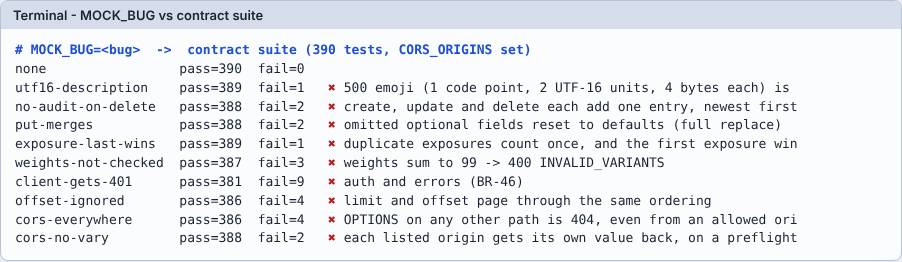
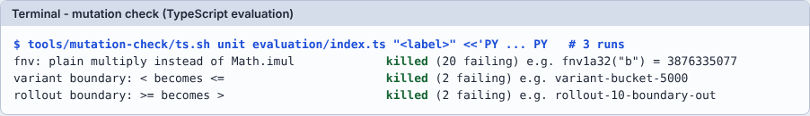

# Module 03: ทำให้พังจงใจ (MOCK_BUG และ mutation)

**เป้าหมาย:** พิสูจน์ว่า test "ล้มได้จริงและล้มด้วยเหตุผลเดียวที่ตั้งใจ" โดยใส่ bug เข้าไปแล้วดูว่า test ตัวไหนจับ: ถ้า bug รอด = test ขาด
**เวลา:** ประมาณ 30 นาที (รัน MOCK_BUG ทั้ง 9 ชนิดใช้ ~1-2 นาที, mutation 1 ข้อ ~7 วินาทีที่วัดได้) · **ระดับ:** กลาง · **ค่าใช้จ่าย:** 0 บาท, รันในเครื่อง · **ใช้ AI:** prompt เขียน test (ไม่บังคับ)
**ก่อนหน้า:** [Module 02](02-run-go-contract.md) · **ถัดไป:** [Module 04](04-port-layer.md)



## ค่าที่ใช้ในแลบ

| รายการ | ค่า |
|---|---|
| Mock server | `tools/mock-server/server.mjs` พอร์ต `8081` (เก็บใน memory ไม่ใช้ DB) |
| `MOCK_BUG` | `utf16-description`, `no-audit-on-delete`, `put-merges`, `exposure-last-wins`, `weights-not-checked`, `client-gets-401`, `offset-ignored`, `cors-everywhere`, `cors-no-vary` |
| `CORS_ORIGINS` | `https://app.example.com,https://b.example.com` (ต้องตั้ง ไม่งั้น bug CORS 2 ตัวไม่มีผล) |
| ตัวรัน | `docs/lab/assets/mock-bugs.sh` (เขียนสำหรับแลบนี้ ใช้พอร์ต 8081 ปิดด้วย PID) |
| Mutation ที่ใช้ (TypeScript) | เปลี่ยน `Math.imul(h, 0x01000193) >>> 0` · เปลี่ยน `if (b < threshold)` เป็น `<=` · เปลี่ยน `>= flag.rolloutPercent * 100` เป็น `>` |

## Prerequisites

Module 02 (รู้จัก contract test และ `BASE_URL`) · Go ไม่ต้องรันใน module นี้

## ขั้นตอน

**1. เปิด mock ที่ไม่มี bug แล้วรัน contract (ต้องผ่านครบ: นี่คือ baseline)**

```bash
( cd "$LAB" && PORT=8081 CORS_ORIGINS="https://app.example.com,https://b.example.com" exec node "$REPO/tools/mock-server/server.mjs" ) &
```

```bash
MOCK_PID=$!
```

```bash
until curl -sf localhost:8081/healthz; do sleep 0.3; done
```

```bash
BASE_URL=http://localhost:8081 CORS_ORIGINS="https://app.example.com,https://b.example.com" node --test --test-concurrency=1 "tests/contract/*.test.mjs" 2>&1 | grep -E '^# (tests|pass|fail)'
```

Expected output:

```text
# tests 390
# pass 390
# fail 0
```

```bash
kill "$MOCK_PID"
```

**2. ใส่ bug ทีละตัวด้วยสคริปต์ (แสดงจำนวนที่ล้มและข้อแรกที่ล้ม)**

```bash
docs/lab/assets/mock-bugs.sh
```

Expected output (ผลจริง; ชื่อข้อแรกถูกตัดที่ 70 ตัวอักษร):

```text
none                 pass=390  fail=0   
utf16-description    pass=389  fail=1   ✖ 500 emoji (1 code point, 2 UTF-16 units, 4 bytes each) is accepted
no-audit-on-delete   pass=388  fail=2   ✖ create, update and delete each add one entry, newest first
put-merges           pass=388  fail=2   ✖ omitted optional fields reset to defaults (full replace)
exposure-last-wins   pass=389  fail=1   ✖ duplicate exposures count once, and the first exposure wins (BR-40
weights-not-checked  pass=387  fail=3   ✖ weights sum to 99 -> 400 INVALID_VARIANTS
client-gets-401      pass=381  fail=9   ✖ auth and errors (BR-46)
offset-ignored       pass=386  fail=4   ✖ limit and offset page through the same ordering
cors-everywhere      pass=386  fail=4   ✖ OPTIONS on any other path is 404, even from an allowed origin: the 
cors-no-vary         pass=388  fail=2   ✖ each listed origin gets its own value back, on a preflight and on a
```

> **Tip:** อ่านสองคอลัมน์ให้ครบ: "จำนวนที่ล้ม" บอกว่ามีกี่ข้อที่ปกป้องพฤติกรรมนั้น (`utf16-description` มีข้อเดียว: ถ้าใครลบข้อนั้นออก bug นี้ผ่านเงียบๆ) และ "ข้อแรกที่ล้ม" ต้องตรงกับพฤติกรรมที่ bug ทำลาย ถ้าล้มด้วยข้ออื่นแปลว่า test ไม่ได้ระบุเจตนาชัด

**3. ดู bug เดียวละเอียดๆ**

```bash
docs/lab/assets/mock-bugs.sh utf16-description
```

Expected output:

```text
utf16-description    pass=389  fail=1   ✖ 500 emoji (1 code point, 2 UTF-16 units, 4 bytes each) is accepted
```

**4. Mutation กับโค้ดจริง (TypeScript, ไม่แก้โค้ดในรีโป: สคริปต์ทำงานบนสำเนาชั่วคราว)** ต้อง `cd typescript && npm ci` มาก่อน (ยังไม่ได้ทดสอบ `npm ci` ในแลบนี้; ในเครื่องผู้เขียนมี `node_modules` อยู่แล้ว)

สคริปต์อ่าน snippet Python จาก stdin ซึ่งแก้ไฟล์ที่รับเป็น `argv[1]` ใช้ `assert` เพื่อให้ mutation ที่ไม่ตรงถูกรายงานแทนที่จะเงียบ:

```bash
tools/mutation-check/ts.sh unit evaluation/index.ts "fnv: plain multiply instead of Math.imul" <<'PY'
import sys; p = sys.argv[1]; s = open(p).read()
a = "Math.imul(h, 0x01000193) >>> 0"; assert a in s
open(p, "w").write(s.replace(a, "(h * 0x01000193) >>> 0"))
PY
```

Expected output:

```text
fnv: plain multiply instead of Math.imul             killed (20 failing) e.g. fnv1a32("b") = 3876335077
```

```bash
tools/mutation-check/ts.sh unit evaluation/index.ts "variant boundary: < becomes <=" <<'PY'
import sys; p = sys.argv[1]; s = open(p).read()
a = "if (b < threshold)"; assert a in s
open(p, "w").write(s.replace(a, "if (b <= threshold)"))
PY
```

Expected output:

```text
variant boundary: < becomes <=                       killed (2 failing) e.g. variant-bucket-5000
```

```bash
tools/mutation-check/ts.sh unit evaluation/index.ts "rollout boundary: >= becomes >" <<'PY'
import sys; p = sys.argv[1]; s = open(p).read()
a = "flag.key, \"rollout\", userId) >= flag.rolloutPercent * 100"; assert a in s
open(p, "w").write(s.replace(a, "flag.key, \"rollout\", userId) > flag.rolloutPercent * 100"))
PY
```

Expected output:

```text
rollout boundary: >= becomes >                       killed (2 failing) e.g. rollout-10-boundary-out
```



ทั้งสามถูกจับโดย vectors ตั้งแต่ชั้น unit (ก่อนถึง HTTP) นี่คือเหตุผลที่ `tests/vectors/` มี case ขอบเขต (bucket 4999/5000, 999/1000)

**5. ลองใส่ mutation ที่ไม่ตรงโค้ด เพื่อเห็นสัญญาณ "NOT APPLIED"**

```bash
tools/mutation-check/ts.sh unit evaluation/index.ts "bucket boundary: < becomes <=" <<'PY'
import sys; p = sys.argv[1]; s = open(p).read()
a = "bucket < threshold"; assert a in s, "pattern"
open(p, "w").write(s.replace(a, "bucket <= threshold"))
PY
```

Expected output (exit code 2):

```text
Traceback (most recent call last):
  File "<stdin>", line 2, in <module>
AssertionError: pattern
NOT APPLIED  bucket boundary: < becomes <=
```

> **Why this matters:** mutation ที่ "ไม่ถูกใช้" ต้องไม่ถูกนับว่า "test จับได้" `cargo fmt` เคยจัดบรรทัดใหม่จน pattern ของ mutation 4 ข้อหาไม่เจอ (`lessons/rust.md`) ทางแก้คือสคริปต์รายงานดังข้างบนแทนที่จะเงียบ

## Prompt สำหรับ AI: เขียน test ตามกติกา CLAUDE.md

ใช้หลังมีโค้ดแล้ว เพื่อให้ AI เพิ่ม test ที่ปิดช่องว่างที่ mutation หรือ MOCK_BUG เปิดโปง (เปลี่ยนค่าในวงเล็บเหลี่ยม)

```text
เพิ่ม unit test สำหรับ [BR-31 และ BR-33: ผลรวม weight ของ variants ต้องเท่ากับ 100 และมีได้ 2-10 variants] ใน [typescript/src/service/]
กติกา (CLAUDE.md):
- ห้ามแก้ spec/, tests/contract/, tests/vectors/ และห้ามข้าม ปิด หรือแก้ test เดิมเพื่อให้ผ่าน
- ห้ามให้ test คำนวณคำตอบที่คาดด้วยตรรกะเดียวกับโค้ดที่ทดสอบ: เขียนค่าที่คาดเป็นค่าตายตัวที่คุณคำนวณด้วยมือหรือมาจาก spec
- กรณี "ต้องล้ม" ต้องล้มด้วยเหตุผลเดียวที่ตั้งใจ เช่น ทดสอบ "เกิน 10 variants" ด้วย 11 variants น้ำหนักรวม 100 (ไม่ใช่ 101)
  และทดสอบ "ผลรวมไม่เท่า 100" ด้วยจำนวน variants ที่ไม่เกินกำหนด
- ทุก test ตั้งชื่อให้บอกพฤติกรรมและ BR ที่ปกป้อง
หลังเขียนเสร็จ: ให้ทำ mutation 3 ข้อกับสำเนาชั่วคราวด้วย tools/mutation-check/ts.sh (ขอบเขต, ชนิด, ลำดับ error)
รายงานผล killed/SURVIVED ของแต่ละข้อ ถ้า SURVIVED ให้เพิ่ม test แล้วรันซ้ำ ห้ามอธิบายว่า "เทียบเท่า" โดยไม่มีหลักฐาน
```

**ทำไม prompt นี้ได้ผล:** สามข้อห้ามแรกมาจากบทเรียนที่ AI พลาดซ้ำในหลายภาษา: test "11 variants" ที่จริงล้มเพราะน้ำหนักรวม 101 (`lessons/rust.md`, `lessons/python.md`), test regex ของ key ที่ใช้ regex เดียวกับโค้ดเป็นตัวตัดสิน (`lessons/java.md`), และ test ที่ไม่มีตัวพิมพ์ใหญ่ปนกลาง (`aB`) mutation จึงรอด บังคับให้ AI วัดผลด้วย mutation ทำให้ "test ผ่าน" กลายเป็นหลักฐานที่ตรวจได้

**สิ่งที่ต้องตรวจจากคำตอบของ AI:**

- [ ] ค่าที่คาดเป็นตัวเลข/สตริงตายตัว ไม่ได้เรียกฟังก์ชันหรือ regex ตัวเดียวกับโค้ด
- [ ] กรณี "ต้องล้ม" แต่ละข้อ: ปรับเงื่อนไขอื่นให้ถูกทั้งหมดแล้วเหลือเงื่อนไขเดียวที่ผิด (11 variants ที่น้ำหนักรวม 100)
- [ ] มีผล mutation แสดงให้เห็น (ชื่อ, killed/SURVIVED, ข้อที่จับ) ไม่ใช่แค่คำอธิบาย
- [ ] ไม่มี `.skip`/`.only`, ไม่มีไฟล์ใน `tests/` ถูกแก้ (`git status`, `git diff --stat`)
- [ ] ถ้าสคริปต์พิมพ์ `NOT APPLIED` หรือ `BUILD FAILED` AI ต้องแก้ mutation ไม่ใช่นับว่าผ่าน

**ตัวอย่างรูปแบบคำตอบ** (ตัวอย่างประกอบ ไม่ได้บันทึกจาก AI):

```text
เพิ่ม 3 test: weights-sum-99-rejected, weights-sum-101-rejected, eleven-variants-sum-100-rejected
mutation: 'ข้ามตรวจผลรวม' killed (2 failing); 'ลิมิต 10 -> 11' killed (1 failing); 'ตรวจ weight เป็นลบ' SURVIVED -> เพิ่ม test negative-weight
```

**ถ้า AI ตอบผิดแบบนี้ ให้ทำ…**

| อาการ | ทำอะไร | ที่มา |
|---|---|---|
| test "เกิน 10 variants" ใช้ 10 ตัว weight 10 + 1 ตัว weight 1 | ชี้ว่าล้มเพราะผลรวม 101 ไม่ใช่จำนวน: ให้ใช้ 11 ตัวที่รวม 100 | `lessons/rust.md` |
| test key ใช้ regex เดียวกับโค้ด | ให้เปลี่ยนเป็นรายการ key ถูก/ผิดที่เขียนตายตัว | `lessons/java.md` |
| mutation ใหญ่เกินไป ทำให้ล้ม 187 ข้อ | ไม่นับ: mutation ที่ดีเปลี่ยนจุดเดียวที่ test ต้องกัน | `lessons/java.md` |
| mutation "events ไม่ atomic" เขียนผิดจนยัง atomic อยู่ | ให้พิสูจน์ก่อนว่า mutation ทำให้พฤติกรรมเปลี่ยนจริง | `lessons/rust.md` |
| ไม่มี test ข้อ "ข้ามตรวจ userId เมื่อมี rule" ทั้งที่ mutation รอด | อาจเป็นช่องว่างของ vectors กลาง ไม่ใช่ความผิดของ AI (ถูกแก้แล้วด้วย vector 2 แถว) | `lessons/rust.md`, `lessons/summary.md` |

## Checkpoint

1. `none` ผ่าน 390 แต่ `put-merges` ล้ม 2 ข้อ: ข้อแรกที่ล้มตรงกับอะไร และทำไมต้องมีมากกว่าหนึ่งข้อ?
2. mutation ที่ SURVIVED หมายความว่าอะไร และมีทางเลือกอะไรบ้าง?
3. ทำไมแลบใช้ mock ไม่ใช่ Go ในการพิสูจน์ว่า test ล้มได้?

<details>
<summary>เฉลย</summary>

1. "omitted optional fields reset to defaults (full replace)": PUT ต้อง replace ไม่ใช่ merge (`tests/contract/README.md`: "PUT เป็น full replace") ข้อที่สอง "PUT can remove all variants again" ปกป้องกรณีเฉพาะ; หลายข้อทำให้ลบข้อเดียวแล้ว bug ยังถูกจับ
2. ไม่มี test ปกป้องพฤติกรรมนั้น: ต้องเพิ่ม test หรืออธิบายพร้อมหลักฐานว่า mutation ไม่เปลี่ยนพฤติกรรม ห้ามบอกลอยๆ ว่า "เทียบเท่า" (port-layer ข้อ 9)
3. mock เป็นอ้างอิงที่ทำตามสเปก (`tests/contract/README.md`): ถ้า mock ผ่านแต่ implementation ไม่ผ่าน มักผิดที่ implementation และ mock ยอมให้ใส่ bug ได้โดยไม่แตะโค้ดส่งมอบ

</details>

## Troubleshooting

| อาการ | แก้ |
|---|---|
| ทุก bug ได้ `fail=0` | ไม่ได้ตั้ง `CORS_ORIGINS` กับ bug CORS, หรือ test ชี้ไปพอร์ตอื่น (ตรวจ `BASE_URL`) |
| `mock ไม่ตอบ /healthz` | พอร์ต 8081 ถูกใช้: ตรวจด้วย `ps -ef | grep mock-server` แล้ว `kill <PID>` |
| `BUILD FAILED (not a valid experiment)` | mutation ทำให้คอมไพล์ไม่ผ่าน: แก้ snippet ให้ยังคอมไพล์ได้ |
| `Cannot find module` ตอน build mutation | ยังไม่ได้ `npm ci` ใน `typescript/` |

## Clean up

```bash
ps -ef | grep "[m]ock-server"
```

ต้องไม่มีผลลัพธ์ (สคริปต์ปิดด้วย PID เองทุกรอบ; ถ้าเหลือจากข้อ 1 ให้ `kill "$MOCK_PID"`) สำเนาชั่วคราวที่ `ts.sh` สร้างอยู่ใต้ `/tmp` และไม่กระทบรีโป
