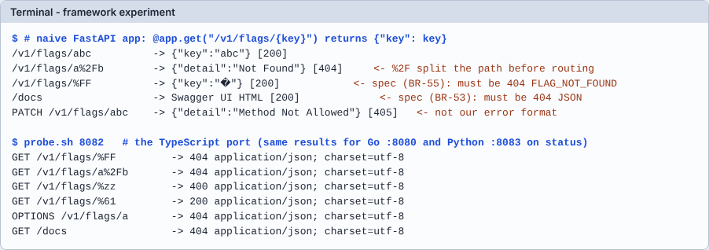

# Module 05: ทดลอง framework ก่อนเขียน handler

**เป้าหมาย:** เห็นด้วยตัวเองว่า framework ทำอะไรกับ path/method/body "ก่อนถึงโค้ดเรา" และเรียนรู้ prompt ที่บังคับให้ AI ทดลองก่อนเขียน แทนที่จะเขียนจากความจำ
**เวลา:** ประมาณ 30 นาที · **ระดับ:** กลาง · **ค่าใช้จ่าย:** 0 บาท, รันในเครื่อง · **ใช้ AI:** prompt ทดลอง (ไม่บังคับ; ข้อ 1-4 ไม่ต้องมี AI)
**ก่อนหน้า:** [Module 04](04-port-layer.md) · **ถัดไป:** [Module 06](06-differential.md)

> บทเรียนที่คุ้มที่สุดของโปรเจกต์นี้ (`lessons/summary.md` หัวข้อ 4: "การทดลอง framework ก่อนเขียน" คุ้มที่สุด): ความเสี่ยงที่ทำนายพลาดทุกภาษามาจากสิ่งที่ framework ทำอยู่ข้างใต้ ไม่ใช่จากตรรกะของเรา



## ค่าที่ใช้ในแลบ

| รายการ | ค่า |
|---|---|
| พอร์ต | แอปทดลอง `8090` · Go `8080` · TypeScript `8082` · Python `8083` |
| Path ที่ทดลอง (มาตรฐานของโปรเจกต์) | `/v1/flags/%FF` · `/v1/flags/%C3%28` · `/v1/flags/%00` · `/v1/flags/a%2Fb` · `/v1/flags/a;b` · `/v1/flags/%zz` · `/v1/flags/%61` (ต้องถอดรหัสเป็น `a` แล้วเจอ flag `a`) |
| Method / path ที่ไม่มี | `PATCH`, `OPTIONS` บน `/v1/flags/a` · `GET /error`, `/docs`, `/openapi.json` · `/v1/%65valuate` |
| กติกาที่ต้องตรง | BR-53 (route/method ที่ไม่มี → 404 JSON `FLAG_NOT_FOUND` ไม่ต้อง auth), BR-55 (`%FF` → 404), BR-57 (path เทียบตามตัวอักษร ยกเว้น key) |
| สคริปต์ | `docs/lab/assets/probe.sh <port>` (เขียนสำหรับแลบ: ยิง path ข้างบนด้วย admin key และสร้าง/ลบ flag `a` ของตัวเอง) |
| Key / header | `X-Admin-Key: test-admin-key` |

## Prerequisites

Module 00 · Python venv ของ `python/` (`$REPO/python/.venv`; สร้างเองด้วย `python3 -m venv .venv && .venv/bin/pip install -r requirements-dev.txt`: ยังไม่ได้ทดสอบในแลบนี้) · สำหรับข้อ 3: build TypeScript (`( cd typescript && npm run build )`)

## ขั้นตอน

**1. เขียนแอปทดลองที่ "เขียนตามธรรมเนียม" ของ FastAPI**

```bash
mkdir -p "$LAB/exp"
```

```bash
cat > "$LAB/exp/naive.py" <<'EOF'
from fastapi import FastAPI

app = FastAPI()


@app.get("/v1/flags/{key}")
def get_flag(key: str):
    return {"key": key}
EOF
```

**2. เปิดและยิง input มาตรฐาน**

```bash
( cd "$LAB/exp" && exec "$REPO/python/.venv/bin/python" -m uvicorn naive:app --port 8090 --log-level warning ) &
```

```bash
EXP_PID=$!
```

```bash
until curl -sf -o /dev/null localhost:8090/openapi.json; do sleep 0.3; done
```

```bash
for p in /v1/flags/abc /v1/flags/a%2Fb /v1/flags/%FF /v1/flags/ /docs /nope; do printf '%-22s -> ' $p; curl -s --path-as-is -o "$LAB/body" -w '[%{http_code}] ' localhost:8090$p; tr -d '\n' < "$LAB/body" | head -c 50; echo; done
```

Expected output (ผลจริง; `--path-as-is` จำเป็น ไม่งั้น curl อาจแก้ path ให้):

```text
/v1/flags/abc          -> [200] {"key":"abc"}
/v1/flags/a%2Fb        -> [404] {"detail":"Not Found"}
/v1/flags/%FF          -> [200] {"key":"�"}
/v1/flags/             -> [404] {"detail":"Not Found"}
/docs                  -> [200]     <!DOCTYPE html>    <html>    <head>    <meta n
/nope                  -> [404] {"detail":"Not Found"}
```

```bash
curl -s -XPATCH -w ' [%{http_code}]\n' localhost:8090/v1/flags/abc
```

Expected output: `{"detail":"Method Not Allowed"} [405]`

อ่านผลเทียบกับสเปก:

| input | framework ทำ | สเปกต้องการ |
|---|---|---|
| `a%2Fb` | แปลง `%2F` เป็น `/` ก่อน routing แล้วไม่ตรง route → 404 `{"detail"...}` (ไม่มีทางถึงโค้ดเรา) | ถึง handler ในฐาน key `a/b` แล้วตอบ 404 `FLAG_NOT_FOUND` ในรูป error ของเรา (และถ้ามี flag key นี้ต้องเจอ) |
| `%FF` | ถอดรหัสเป็น U+FFFD แล้ว **ตอบ 200** | BR-55: 404 `FLAG_NOT_FOUND` |
| `/docs` | หน้า Swagger 200 | BR-53: 404 JSON |
| `PATCH` | 405 `{"detail"...}` | BR-53: 404 `FLAG_NOT_FOUND` |
| 404 ทุกแบบ | `{"detail": "Not Found"}` | `{"error":{"code","message"}}` |

> **Why this matters:** ถ้า AI เขียน handler "ตามธรรมเนียมของ framework" ทุกแถวข้างบนผิดสเปกโดยที่โค้ดดู "ถูกต้อง" และ unit test ของ logic ผ่านหมด

```bash
kill "$EXP_PID"
```

```bash
ps -o pid,args -p "$EXP_PID" || echo "ไม่มีโปรเซส (ถูกต้อง)"
```

**3. ยิง input ชุดเดียวกันกับพอร์ตจริง (ที่ผ่านการทดลองและแก้แล้ว)**

เปิด Go, TypeScript, Python บนพอร์ต 8080, 8082, 8083 (DB แยกกัน) ถ้า TypeScript ยังไม่ build: `( cd typescript && npm run build )`

```bash
( cd "$LAB/run" && ADMIN_KEY=test-admin-key CLIENT_KEY=test-client-key PORT=8080 DB_PATH="$LAB/run/p-go.db" exec "$LAB/ffservice" ) &
```

```bash
GO_PID=$!
```

```bash
( cd typescript && ADMIN_KEY=test-admin-key CLIENT_KEY=test-client-key PORT=8082 DB_PATH="$LAB/run/p-ts.db" exec node dist/server.js ) &
```

```bash
TS_PID=$!
```

```bash
( cd python && ADMIN_KEY=test-admin-key CLIENT_KEY=test-client-key PORT=8083 DB_PATH="$LAB/run/p-py.db" exec .venv/bin/python -m app.main ) &
```

```bash
PY_PID=$!
```

```bash
for p in 8080 8082 8083; do until curl -sf -o /dev/null localhost:$p/healthz; do sleep 0.3; done; done
```

```bash
docs/lab/assets/probe.sh 8080
```

Expected output (Go):

```text
GET /v1/flags/%FF                  -> 404 application/json
GET /v1/flags/%C3%28               -> 404 application/json
GET /v1/flags/%00                  -> 404 application/json
GET /v1/flags/a%2Fb                -> 404 application/json
GET /v1/flags/a;b                  -> 404 application/json
GET /v1/flags/%zz                  -> 400 text/plain; charset=utf-8
GET /v1/flags/%61                  -> 200 application/json
PATCH /v1/flags/a                  -> 404 application/json
OPTIONS /v1/flags/a                -> 404 application/json
GET /error                         -> 404 application/json
GET /docs                          -> 404 application/json
GET /openapi.json                  -> 404 application/json
GET /v1/%65valuate                 -> 404 application/json
```

```bash
docs/lab/assets/probe.sh 8082
```

Expected output (TypeScript): เหมือน Go ทุกแถวในด้านสถานะ ต่างที่ `Content-Type` เป็น `application/json; charset=utf-8` และ `%zz` ตอบ `400 application/json; charset=utf-8` (Go ตอบ `text/plain`)

```bash
docs/lab/assets/probe.sh 8083
```

Expected output (Python): เหมือน TypeScript แต่ `Content-Type` เป็น `application/json` (ไม่มี charset) และ `%zz` ตอบ `400 application/json`

```text
GET /v1/flags/%zz                  -> 400 application/json
GET /v1/flags/%61                  -> 200 application/json
OPTIONS /v1/flags/a                -> 404 application/json
GET /docs                          -> 404 application/json
```

(แสดงเฉพาะแถวสำคัญ: แถวที่เหลือเป็น `404 application/json` เหมือนกัน)

ความต่างของ `%zz` (Go `text/plain`, อีกสองภาษา JSON) เป็น "ความต่างที่ยอมรับ" ที่บันทึกไว้ใน `docs/porting/python-analysis.md` ข้อ 6: สเปกกำหนดแค่สถานะ 400 และ contract test ตรวจเฉพาะสถานะ

**4. เทียบกับสิ่งที่ภาษาอื่นเจอ** (ข้อมูลจาก `docs/porting/*-analysis.md` **ไม่ได้รันซ้ำในแลบนี้**: เป็นผลของผู้เขียนเอกสารเหล่านั้น)

| framework | ที่ทดลองแล้วเจอ | ผลต่อการออกแบบ |
|---|---|---|
| Spring Boot บน Tomcat/Jetty (Java) | `%FF`, `%00`, `a%2Fb` ตอบ 400 **HTML** ก่อนถึงโค้ด (Jetty ตอบ HTML เฉพาะ `%00`) | เปลี่ยนเป็น Undertow (`decode-url=false`) |
| Spring MVC บน Undertow (Java) | ตัด `;param` จาก path, `OPTIONS` ตอบ 200 ว่าง, `GET /error` ตอบ JSON ของ Boot, `TRACE` สะท้อน request, `%zz` → 500 | เลิกใช้ controller ทำ routing เองใน servlet filter |
| axum (Rust) | extractor `Path` ตอบ 400 กับ `%FF`; extractor `Bytes`/`Json` ตอบ 413 ข้อความธรรมดา | ห้ามใช้ extractor เหล่านี้ ตัด key จาก `uri.path()` แล้วถอดรหัสเอง |
| Fastify (TypeScript) | `/v1/flags/` (key ว่าง) ตอบ 401 แทน 404; key ยาว > 100 ตัวได้ 400 | hook `nonEmptyKey`, ตั้ง `maxParamLength` |
| FastAPI/uvicorn (Python) | `%2F` ถูกแปลงก่อน routing (พบหลังแปล ไม่ได้ทำนาย), `/docs` เปิดอยู่, `redirect_slashes` | `_route_path`, ปิด docs, `redirect_slashes=False` |

## Prompt สำหรับ AI: ทดลอง framework ก่อนเขียน handler

ใช้ก่อน layer handler ทุกภาษา (ตรงกับหัวข้อ "ก่อนเขียน handler: ทดลอง framework (บังคับ)" ใน `CONVENTIONS.md` และข้อ 3 ของ skill `port-layer`) เปลี่ยนค่าในวงเล็บเหลี่ยมเป็นภาษา/framework เป้าหมาย

```text
ก่อนเขียน layer handler เป็น [Rust (axum)] ให้ทดลองกับ framework จริง ห้ามตอบจากความจำ
1. เขียนโปรแกรมทิ้ง (ไม่อยู่ในรีโป) ที่มี route GET /v1/flags/{key} เปล่าๆ แล้วเปิด server จริง
   เปิดด้วย ( cd dir && exec คำสั่ง ) & เก็บ $! รอ /healthz ปิดด้วย PID เท่านั้น (ห้าม pkill/killall)
2. ยิงด้วย curl --path-as-is ทุกข้อ: path (/v1/flags/%FF, %C3%28, %00, %7F, %2F, %2f, %252F, a;b, %zz, a%, ว่าง, //, key ยาว 5,000 ตัว, %61 ต้องเจอ flag a),
   method (PATCH/OPTIONS/TRACE/HEAD บน path ที่มีและไม่มี method นั้น, GET /error /docs /openapi.json),
   header (key เป็นไบต์ Latin-1, ff fe, ยาว 5,000, header ซ้ำ),
   body (UTF-8 ผิด, UTF-16, BOM, NaN/Infinity, 01, .5, comment, comma ท้าย, key ซ้ำ, ซ้อนลึก 100,000 ชั้น, เลข 5,000 หลัก, 1e999, lone surrogate, เกิน 1 MiB, Content-Type ผิดชนิด),
   และ panic/exception ใน handler (ลูกค้าได้ 500 JSON หรือ connection ถูกปิด?)
3. บันทึกผลเป็นตาราง (input, สิ่งที่ framework ทำ, สถานะ/รูป body, ตรงกับ BR-xx ไหม) ลง docs/porting/[rust]-analysis.md หัวข้อ "การทดลอง framework"
4. ตารางสุดท้าย: แถวไหนขัดกับสเปก และวิธีรับมือ (เปลี่ยน server, ทำ routing/อ่าน body เอง) ห้ามเสนอให้แก้สเปกให้ตรงกับ framework
ห้ามเริ่มเขียน handler จนกว่าตารางเสร็จและฉันอนุมัติ
```

**ทำไม prompt นี้ได้ผล:** "ห้ามตอบจากความจำ" และ "เปิด server จริง" ทำให้ได้ข้อมูลที่ตรวจซ้ำได้ (การทดลองของ Java เปลี่ยนการออกแบบทั้งชั้น); รายการ input ครบมาจากสิ่งที่ทำนายพลาดทั้ง 4 ภาษา; ข้อ 4 กัน AI ลดมาตรฐานให้เข้ากับ framework; "รออนุมัติ" คือจุดที่คนตัดสิน

**สิ่งที่ต้องตรวจจากคำตอบของ AI:**

- [ ] มีตารางผลจริง (สถานะ/Content-Type/ข้อความ) ไม่ใช่คำอธิบายว่า "framework น่าจะ…"
- [ ] ทุกกลุ่ม (path, method, header, body, ล้มเหลว) มีแถว และ route ที่ทดลอง **มี param** (`/v1/flags/{key}`): ทดลองกับ route ที่ไม่มี param ทำให้พลาดกรณี key ว่างของ Fastify
- [ ] ใช้ `curl --path-as-is` (หรือ client ที่ไม่ normalize path)
- [ ] คำตอบเขียนวิธีรับมือเป็นรูปธรรม (เช่น "ตัด key จาก uri.path() เอง") ไม่ใช่ "ปรับสเปก"
- [ ] ไม่มี server ค้าง: `ps -ef | grep <ชื่อโปรแกรม>`
- [ ] ยังไม่มีไฟล์ handler ในรีโป

**ตัวอย่างรูปแบบตารางที่ต้องได้** (ตัวอย่างจากผลจริงของ axum ใน `docs/porting/rust-analysis.md` ข้อ 4):

```text
| path               | สิ่งที่ extractor Path ทำ | ตรง BR-55? |
| /v1/flags/%FF      | 400 "Invalid UTF-8 in key" ก่อนถึงโค้ดเรา | ไม่ -> ห้ามใช้ extractor Path |
| /v1/flags/a%2Fb    | key = a/b (ยัง 1 segment) | ใช่ |
```

**ถ้า AI ตอบผิดแบบนี้ ให้ทำ…**

| อาการ | ทำอะไร | ที่มา |
|---|---|---|
| ทดลองกับ route ที่ไม่มี param | ให้ทดลองกับ `/v1/flags/{key}` จริง | `lessons/typescript.md` (`GET /v1/flags/` ตอบ 401) |
| ทดลอง `%2F` แต่ไม่ทดลองว่า routing ทำอะไรกับมัน | ให้ทดสอบกรณี "flag key `a/b` เจอได้ไหม" ผ่านทั้ง routing | `lessons/python.md` (`%2F` ไม่เคยทำนาย) |
| ไม่ทดลอง `OPTIONS`, `TRACE`, `/error` | ชี้ว่าเป็นหัวข้อบังคับ (Spring ตอบ 200 ว่าง / JSON ของ Boot) | `lessons/java.md` |
| สรุปว่า "framework ทำตามสเปกอยู่แล้ว" ทั้งที่ไม่มีข้อมูล | ไม่รับ: ขอผลดิบของแต่ละแถว | CONVENTIONS.md |
| เปิด server ด้วย `A && B &` แล้วปิดไม่ได้ | ชี้ข้อห้ามใน CLAUDE.md; ตรวจด้วย `ps` | `lessons/typescript.md`, `lessons/python.md` |
| เสนอแก้สเปกให้ "สอดคล้องกับ framework" | ปฏิเสธ: เปลี่ยน server หรือเขียน routing เอง | CONVENTIONS.md |

## Checkpoint

1. ทำไม `%FF` → 200 ในแอปเปล่าจึงเป็น "bug" ทั้งที่ไม่มีโค้ดผิด?
2. ทำไมต้องใช้ `--path-as-is`?
3. `%61` ในผล probe ต้องได้ 200 เพราะอะไร?

<details>
<summary>เฉลย</summary>

1. BR-55 กำหนดว่า key ที่ decode เป็น UTF-8 ไม่ได้คือ key ธรรมดาที่ไม่มี → 404; framework แทนที่ด้วย U+FFFD แล้วส่งต่อ ผลจึงต่างโดยไม่มีบรรทัดไหนในโค้ดเราผิด
2. curl จะ normalize path บางแบบ (เช่น `//`, `/./`) ทำให้ไม่ได้ส่งสิ่งที่ตั้งใจ
3. BR-57 ให้ถอดรหัสเฉพาะ key ของ flag: `%61` คือ `a` ซึ่ง `probe.sh` สร้างไว้ก่อน (contract ถูกเพิ่มข้อ "key ที่เข้ารหัสแล้วเจอ flag จริง" ภายหลัง: `lessons/summary.md`)

</details>

## Troubleshooting

| อาการ | แก้ |
|---|---|
| `No module named uvicorn` | ใช้ `$REPO/python/.venv/bin/python` ที่ติดตั้ง `requirements-dev.txt` แล้ว |
| `probe.sh` ได้ `000` | server ไม่ตอบ: ตรวจ `until curl ... /healthz` และพอร์ต |
| `%61` ได้ 404 | `probe.sh` สร้าง flag `a` ไม่สำเร็จ (มีอยู่แล้ว หรือ admin key ผิด) ลองลบ DB ของพอร์ตนั้นแล้วเริ่มใหม่ |
| terminal แสดง `%FF` เป็นเครื่องหมายคำถาม | ปกติ: ไบต์ไม่ใช่ UTF-8 ที่ถูกต้อง |

## Clean up

```bash
kill "$GO_PID" "$TS_PID" "$PY_PID"
```

```bash
ps -ef | grep -E "ffservice|dist/server.js|app.main|uvicorn" | grep -v grep || echo "ไม่มีโปรเซสค้าง (ถูกต้อง)"
```

```bash
rm -rf "$LAB/exp" "$LAB/run"/p-*.db*
```
