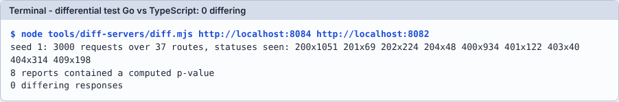
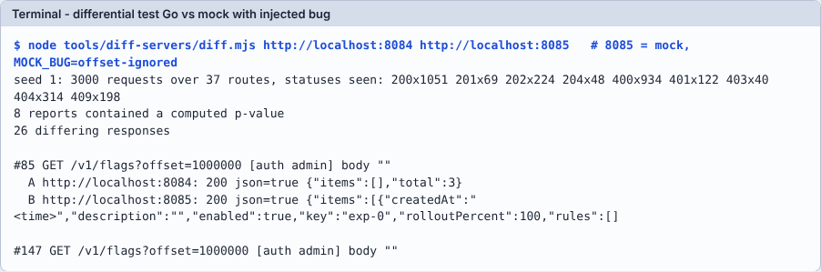

# Module 06: Differential test

**เป้าหมาย:** ยิง request สุ่มชุดเดียวกันไปที่ service สองตัวแล้วดูว่าคำตอบต่างกันตรงไหน: หา "สิ่งที่ทั้งสองผ่าน test แต่ไม่มีใครคิดจะเขียน test"
**เวลา:** ประมาณ 20 นาที (diff 3,000 request ใช้ ~7 วินาทีที่วัดได้) · **ระดับ:** กลาง · **ค่าใช้จ่าย:** 0 บาท, รันในเครื่อง · **ใช้ AI:** prompt วิเคราะห์ผล (ไม่บังคับ)
**ก่อนหน้า:** [Module 05](05-framework-experiments.md) · **ถัดไป:** [Module 07](07-sdk-cors.md)



## ค่าที่ใช้ในแลบ

| รายการ | ค่า |
|---|---|
| เครื่องมือ | `node tools/diff-servers/diff.mjs <urlA> <urlB> [--seed=1] [--requests=3000] [--show=10]` |
| ข้อบังคับ | service ทั้งสองต้องเริ่มจาก **ฐานข้อมูลว่าง** และใช้ `test-admin-key` / `test-client-key`; ลำดับ request เป็นฟังก์ชันของ seed อย่างเดียว |
| พอร์ต | Go อ้างอิง 3 ตัว `8084`, `8086`, `8087` (ตัวละหนึ่งการเทียบ เพราะ DB ต้องสะอาด) · TypeScript `8082` · Python `8083` · mock ที่ใส่ bug `8085` |
| Bug ที่ใส่ | `MOCK_BUG=offset-ignored` (list ไม่สนใจ `offset`) |
| ค่าที่คาด | Go↔TypeScript: 0 · Go↔Python: 0 · Go↔mock: 26 (seed 1, 3000 request) |
| ไม่นับเป็นความต่าง (ตั้งใจ) | timestamp, ข้อความ `message`, p-value เกิน 1e-9 สัมพัทธ์ |

## Prerequisites

Module 00 และ 05 (TypeScript ที่ build แล้ว, Python venv) · ปิด server ทั้งหมดของ module ก่อนหน้า

## ขั้นตอน

**1. เปิดทุกอย่างด้วย DB ใหม่** (ลบ DB เก่าก่อน)

```bash
rm -f "$LAB/run"/d-*.db*
```

```bash
( cd "$LAB/run" && ADMIN_KEY=test-admin-key CLIENT_KEY=test-client-key PORT=8084 DB_PATH="$LAB/run/d-go1.db" exec "$LAB/ffservice" ) &
```

```bash
GO1_PID=$!
```

```bash
( cd "$LAB/run" && ADMIN_KEY=test-admin-key CLIENT_KEY=test-client-key PORT=8086 DB_PATH="$LAB/run/d-go2.db" exec "$LAB/ffservice" ) &
```

```bash
GO2_PID=$!
```

```bash
( cd "$LAB/run" && ADMIN_KEY=test-admin-key CLIENT_KEY=test-client-key PORT=8087 DB_PATH="$LAB/run/d-go3.db" exec "$LAB/ffservice" ) &
```

```bash
GO3_PID=$!
```

```bash
( cd typescript && ADMIN_KEY=test-admin-key CLIENT_KEY=test-client-key PORT=8082 DB_PATH="$LAB/run/d-ts.db" exec node dist/server.js ) &
```

```bash
TS_PID=$!
```

```bash
( cd python && ADMIN_KEY=test-admin-key CLIENT_KEY=test-client-key PORT=8083 DB_PATH="$LAB/run/d-py.db" exec .venv/bin/python -m app.main ) &
```

```bash
PY_PID=$!
```

```bash
( cd "$LAB" && PORT=8085 MOCK_BUG=offset-ignored exec node "$REPO/tools/mock-server/server.mjs" ) &
```

```bash
MOCK_PID=$!
```

```bash
for p in 8084 8086 8087 8082 8083 8085; do until curl -sf -o /dev/null localhost:$p/healthz; do sleep 0.3; done; done
```

**2. Go เทียบ TypeScript**

```bash
node tools/diff-servers/diff.mjs http://localhost:8084 http://localhost:8082
```

Expected output (ผลจริง):

```text
seed 1: 3000 requests over 37 routes, statuses seen: 200x1051 201x69 202x224 204x48 400x934 401x122 403x40 404x314 409x198
8 reports contained a computed p-value
0 differing responses
```

บรรทัดสถานะบอกว่ามี 37 route และสถานะ 9 แบบถูกเรียกจริง: ถ้า "0 ความต่าง" มาจาก request ที่ไม่ได้ทดสอบอะไร ตัวเลขนี้จะเห็นเป็นแค่ 404 ทั้งหมด

**3. Go เทียบ Python**

```bash
node tools/diff-servers/diff.mjs http://localhost:8086 http://localhost:8083
```

Expected output: เหมือนข้อ 2 (บรรทัดแรกเหมือนเดิมทุกตัวอักษร เพราะ seed เดียวกัน) และ `0 differing responses`

**4. Go เทียบ mock ที่ใส่ bug**

```bash
node tools/diff-servers/diff.mjs http://localhost:8087 http://localhost:8085 --show=2
```

Expected output (ผลจริง ตัดบรรทัดยาวแล้ว):

```text
seed 1: 3000 requests over 37 routes, statuses seen: 200x1051 201x69 202x224 204x48 400x934 401x122 403x40 404x314 409x198
8 reports contained a computed p-value
26 differing responses

#85 GET /v1/flags?offset=1000000 [auth admin] body ""
  A http://localhost:8087: 200 json=true {"items":[],"total":3}
  B http://localhost:8085: 200 json=true {"items":[{"createdAt":"<time>","description":"","enabled":true,"key":"exp-0",...
```



อ่านความต่าง: request #85 ขอ `offset=1000000` Go ตอบหน้าว่าง (`items: []`, `total: 3`) แต่ mock ที่ใส่ bug ตอบรายการเต็ม: ตรงกับ `MOCK_BUG=offset-ignored` ที่ module 03 รู้ว่า contract จับได้ 4 ข้อ

> **Why this matters:** ในโปรเจกต์จริง differential จับได้ 2 ครั้งที่ contract ไม่รู้: ขอบ 30 exposure ที่ TypeScript (สเปกมีเกณฑ์ 30 แต่ test ทดสอบแค่ 29 กับ 200) และ `%2F` ที่ Python (`lessons/summary.md` ข้อ 4) ทั้งสองถูกเพิ่มเป็น contract test ภายหลัง: differential คือเครื่องมือหา test ที่ขาด ไม่ใช่ตัวแทน test

**5. (ไม่บังคับ) เปลี่ยน seed เพื่อสุ่มชุดใหม่**: ต้องใช้ DB ว่างใหม่ทุกครั้ง จึงต้อง clean up แล้วเริ่มข้อ 1 ใหม่ ผู้เขียนแลบรัน seed 1 เท่านั้น; เอกสาร `lessons/rust.md` บันทึกว่ารัน seed 1-3, 11-12 และ Java↔Rust seed 41 ได้ 0 ความต่าง (ไม่ได้รันซ้ำในแลบนี้)

## Prompt สำหรับ AI: วิเคราะห์ผล differential

ใช้เมื่อได้ความต่างมากกว่า 0 (ตรงกับข้อ 6-7 ของ skill `verify-gates`) วางผลของ `diff.mjs` ต่อท้าย prompt

```text
ด้านล่างคือผลของ node tools/diff-servers/diff.mjs ระหว่าง A (Go ต้นฉบับ) กับ B ([TypeScript])
ห้ามแก้ไฟล์ใดๆ ก่อน
สำหรับ "แต่ละกลุ่มของความต่าง" (จัดกลุ่มตาม route + สาเหตุ ไม่ใช่ทีละ request):
1. ระบุว่าสเปก (spec/business-rules.md, spec/evaluation.md, spec/openapi.yaml) ตัดสินเรื่องนี้ไว้หรือไม่ อ้าง BR-xx หรือบรรทัด
2. ถ้าสเปกตัดสิน: ฝั่งไหนผิด (A หรือ B) พร้อมหลักฐาน
3. ถ้าสเปกเงียบ: เสนอข้อความที่ควรเพิ่มในสเปก และ contract test ที่ควรเพิ่ม (บอกเป็นข้อเสนอ ห้ามเพิ่มเอง เพราะห้ามแก้ spec/ และ tests/ โดยไม่ได้สั่ง)
4. ความต่างที่ยอมรับได้ต้องบอกเหตุผลและบันทึกใน docs/porting/[typescript]-analysis.md หัวข้อ "ความต่างที่ยอมรับ" ตามที่ฉันอนุมัติเท่านั้น
สรุปท้ายเป็นตาราง: กลุ่ม | ผิดที่ (โค้ด A / โค้ด B / test / สเปก) | หลักฐาน | สิ่งที่เสนอ
ผล diff:
[วางผลที่นี่]
```

**ทำไม prompt นี้ได้ผล:** บังคับให้ตัดสินด้วยสเปกก่อน (ลำดับความจริง: spec > tests > โค้ด; Go เองก็เคยผิด เช่น timestamp และ UTF-8 ในบทเรียน `lessons/summary.md` ตารางข้อ 2); การจัดกลุ่มกัน AI ไล่แก้ทีละ request; ข้อ 3 ส่งความต่างที่สเปกเงียบกลับไปหาคน

**สิ่งที่ต้องตรวจจากคำตอบของ AI:**

- [ ] ทุกกลุ่มมี BR-xx หรือบรรทัดของสเปกที่เปิดดูแล้วมีข้อความนั้นจริง
- [ ] ไม่ถือว่า "Go ถูกเพราะเป็นต้นฉบับ"
- [ ] ข้อเสนอเพิ่ม test ระบุ input และผลที่คาดเป็นรูปธรรม
- [ ] ยังไม่มีไฟล์ใดถูกแก้ (`git status`)

**ตัวอย่างรูปแบบคำตอบ** (ตัวอย่างประกอบ ไม่ได้บันทึกจาก AI):

```text
| กลุ่ม | ผิดที่ | หลักฐาน | สิ่งที่เสนอ |
| GET /v1/flags?offset=N เกินจำนวน | B | BR-50 offset >= 0 ตัด total ก่อนแบ่งหน้า | แก้ B; contract มีแล้ว ("offset past the end gives an empty page") |
```

**ถ้า AI ตอบผิดแบบนี้ ให้ทำ…**

| อาการ | ทำอะไร | ที่มา |
|---|---|---|
| ถือ Go เป็นความจริงโดยอัตโนมัติ | ย้ำลำดับ spec > tests > โค้ด | CLAUDE.md, `lessons/summary.md` |
| แก้ B ให้เหมือน A ทั้งที่สเปกเงียบ | หยุด: ถามคน/เพิ่มข้อสมมติ ห้ามเดากติกาที่สเปกไม่ได้บอก | CLAUDE.md |
| รัน differential สองชุดพร้อมกันบนพอร์ตเดียวกัน | ทีละชุด; `ECONNREFUSED` คือสัญญาณ | `lessons/typescript.md` |
| รันกับ DB ที่ไม่ว่าง แล้วบอกว่ามีความต่างเป็นพัน | เริ่มใหม่ด้วย DB ว่าง (เงื่อนไขของเครื่องมือ) | header ของ `diff.mjs` |

## Checkpoint

1. ทำไมต้องใช้ Go 3 ตัวแทน 1 ตัว?
2. "0 differing responses" พิสูจน์อะไร และไม่พิสูจน์อะไร?
3. ทำไม diff ไม่เทียบ `message` และ timestamp?

<details>
<summary>เฉลย</summary>

1. หลัง request ชุดแรก DB ของ Go ไม่ว่างแล้ว การเทียบครั้งที่สองจะเริ่มจากสถานะต่างกัน จึงเป็นความต่างปลอม
2. พิสูจน์ว่าสองตัวตอบเหมือนกันสำหรับ 3,000 request จาก seed 1 ที่ครอบ 37 route; ไม่พิสูจน์ว่าทั้งสองถูกตามสเปก (ผิดเหมือนกันก็ได้) และไม่ครอบ input ที่เครื่องมือไม่สร้าง (header ซ้ำ, lone surrogate, path ไม่สะอาดอย่าง `//`: ระบุไว้ใน header ของ `diff.mjs`)
3. สเปกเปรียบเทียบเฉพาะ `error.code` และรูปแบบเวลาต่างกันได้อย่างถูกต้อง (`tests/contract/README.md`)

</details>

## Troubleshooting

| อาการ | แก้ |
|---|---|
| ความต่างเป็นพัน | DB ไม่ว่าง: ลบ `$LAB/run/d-*.db*` และเริ่มข้อ 1 ใหม่ |
| `ECONNREFUSED` | server ตัวใดตัวหนึ่งไม่ขึ้น: ตรวจ `/healthz` ของทุกพอร์ต |
| `Cannot find module dist/server.js` | ยังไม่ได้ `( cd typescript && npm run build )` |
| ผลต่างจากตาราง | ยืนยันว่า seed/requests เป็นค่าเริ่มต้น และเวอร์ชันโค้ดเท่ากับรีโปปัจจุบัน |

## Clean up

```bash
kill "$GO1_PID" "$GO2_PID" "$GO3_PID" "$TS_PID" "$PY_PID" "$MOCK_PID"
```

```bash
ps -ef | grep -E "ffservice|dist/server.js|app.main|mock-server" | grep -v grep || echo "ไม่มีโปรเซสค้าง (ถูกต้อง)"
```

```bash
rm -f "$LAB/run"/d-*.db*
```
