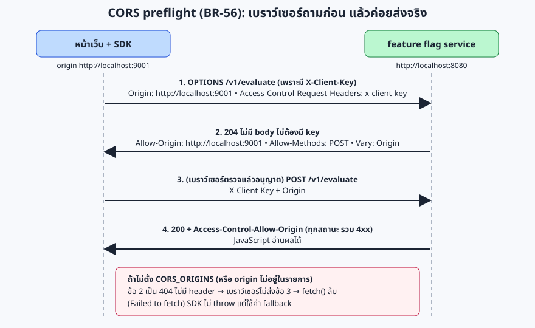
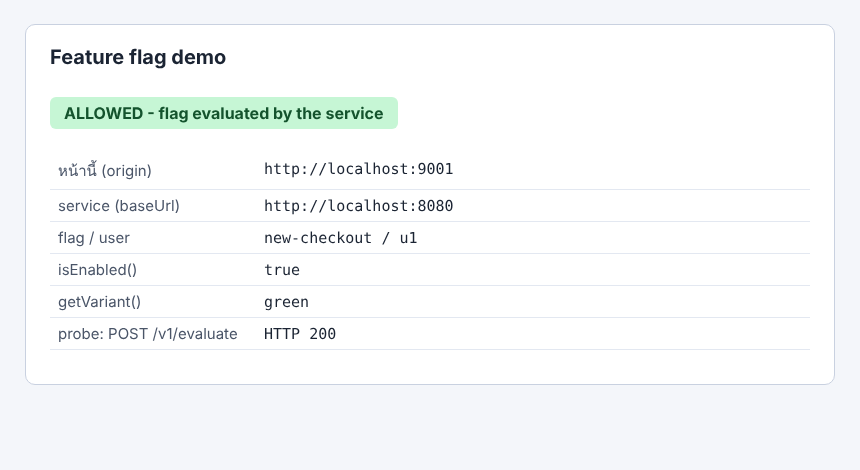
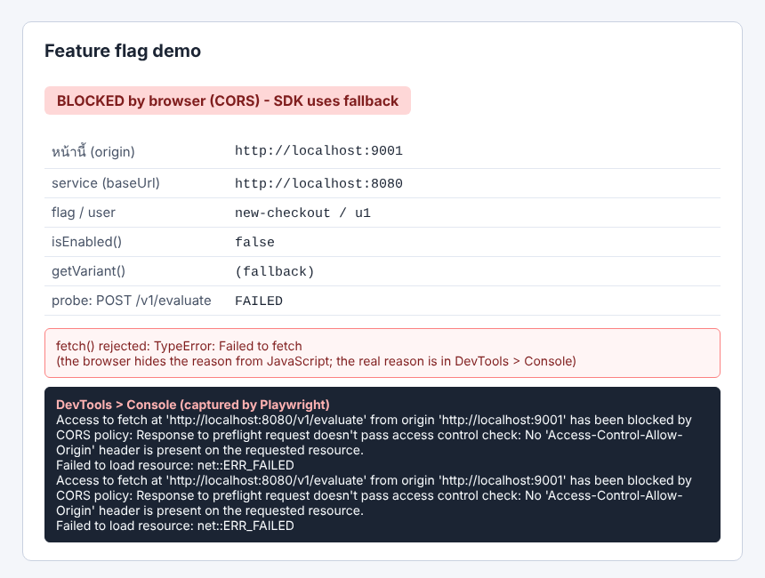

# Module 07: JS SDK, CORS และเบราว์เซอร์จริง

**เป้าหมาย:** เข้าใจ CORS (BR-56/BR-57) ด้วยการเห็นมันทำงานในเบราว์เซอร์จริง: Node ไม่มี CORS จึงจับเรื่องนี้ไม่ได้ ผ่านทุก test แล้วก็ยังใช้งานจริงไม่ได้ได้
**เวลา:** ประมาณ 30 นาที · **ระดับ:** กลาง · **ค่าใช้จ่าย:** 0 บาท, รันในเครื่อง · **ใช้ AI:** prompt ตรวจ (ไม่บังคับ)
**ก่อนหน้า:** [Module 06](06-differential.md) · **ถัดไป:** [Module 08](08-review.md)



> ผ่านทุก gate แต่ผู้ใช้เห็นว่าผิด: CORS คือตัวอย่างจริงของโปรเจกต์นี้ (`lessons/summary.md` เกณฑ์ข้อ 5) SDK ใช้ข้าม origin ไม่ได้ทั้งที่ contract/unit ผ่านหมด จึงต้องมี gate ชนิดใหม่: "ใช้งานจริงจากเบราว์เซอร์"

## ค่าที่ใช้ในแลบ

| รายการ | ค่า |
|---|---|
| Service | Go พอร์ต `8080` (`http://localhost:8080`) |
| หน้าเว็บ | เสิร์ฟจากรีโปด้วย `python3 -m http.server 9001` → origin `http://localhost:9001` |
| URL หน้าทดลอง | `http://localhost:9001/docs/lab/assets/demo.html?svc=http://localhost:8080` (ปรับได้: `&flag=…&user=…&clientKey=…`; ค่าเริ่มต้น flag `new-checkout`, user `u1`, key `test-client-key`) |
| `CORS_ORIGINS` | เปิด: `http://localhost:9001` · ปิด: ไม่ตั้ง |
| SDK | `sdk-js/dist/index.umd.js` (global `FeatureFlags.FlagClient`) |
| Flag ที่ใช้ | `{"key":"new-checkout","enabled":true,"variants":[{"key":"blue","weight":50},{"key":"green","weight":50}]}` · user `u1` ได้ `green` (bucket 7181) |
| ผลที่คาด | เปิด CORS: `isEnabled()=true`, `getVariant()=green`, probe HTTP 200 · ปิด CORS: `false`, `(fallback)`, probe FAILED |
| ตัวตรวจอัตโนมัติ | `tools/browser-check` (Playwright 1.63.0, Chromium) `EXPECT=allowed` / `EXPECT=blocked` |

## Prerequisites

Module 00-02 · เบราว์เซอร์ (ปกติของคุณ) · `sdk-js/dist/index.umd.js` มีอยู่ (ถ้าไม่มี: `( cd sdk-js && npm install && npm run build )` ยังไม่ได้ทดสอบ)

## ขั้นตอน

**1. ตรวจว่า SDK build แล้ว**

```bash
ls -l sdk-js/dist/index.umd.js
```

**2. เปิด Go โดยอนุญาต origin ของหน้าทดลอง**

```bash
( cd "$LAB/run" && ADMIN_KEY=test-admin-key CLIENT_KEY=test-client-key PORT=8080 DB_PATH="$LAB/run/c.db" CORS_ORIGINS=http://localhost:9001 exec "$LAB/ffservice" ) &
```

```bash
GO_PID=$!
```

```bash
until curl -sf localhost:8080/healthz; do sleep 0.3; done
```

**3. ดู preflight ด้วย `curl` (สิ่งที่เบราว์เซอร์ทำให้เบื้องหลัง)**

```bash
curl -s -i -XOPTIONS localhost:8080/v1/evaluate -H 'Origin: http://localhost:9001' -H 'Access-Control-Request-Method: POST' -H 'Access-Control-Request-Headers: content-type,x-client-key' | sed -n '1,6p'
```

Expected output (ผลจริง):

```text
HTTP/1.1 204 No Content
Access-Control-Allow-Headers: Content-Type, X-Client-Key
Access-Control-Allow-Methods: POST
Access-Control-Allow-Origin: http://localhost:9001
Access-Control-Max-Age: 600
Vary: Origin
```

origin ที่ไม่อยู่ในรายการ และ request ที่ไม่มี `Origin` ถูกปฏิบัติเหมือน route ที่ไม่มี (BR-53):

```bash
curl -s -o /dev/null -w '%{http_code}\n' -XOPTIONS localhost:8080/v1/evaluate -H 'Origin: https://evil.example.com'
```

Expected output: `404`

```bash
curl -s -o /dev/null -w '%{http_code}\n' -XOPTIONS localhost:8080/v1/evaluate
```

Expected output: `404`

ทุก response ของ `POST /v1/evaluate` มี header CORS แม้จะเป็น 401 (เพื่อให้ JavaScript อ่าน error ได้):

```bash
curl -s -i -XPOST localhost:8080/v1/evaluate -H 'Origin: http://localhost:9001' -H 'X-Client-Key: wrong' -d '{}' | grep -iE '^(HTTP|access-control|vary)'
```

Expected output:

```text
HTTP/1.1 401 Unauthorized
Access-Control-Allow-Origin: http://localhost:9001
Vary: Origin
```

admin API ไม่มี CORS (admin key ต้องไม่ถูกใช้จากเบราว์เซอร์): คำสั่งนี้ต้องนับได้ 0

```bash
curl -s -i localhost:8080/v1/flags -H 'X-Admin-Key: test-admin-key' -H 'Origin: http://localhost:9001' | grep -ci 'access-control'
```

Expected output: `0`

BR-57: endpoint เขียนแบบเข้ารหัสไม่ใช่ endpoint:

```bash
curl -s --path-as-is -i -XOPTIONS localhost:8080/v1/%65valuate -H 'Origin: http://localhost:9001' | sed -n '1p'
```

Expected output: `HTTP/1.1 404 Not Found`

**4. สร้าง flag และเสิร์ฟหน้าทดลอง**

```bash
curl -s -XPOST localhost:8080/v1/flags -H 'X-Admin-Key: test-admin-key' -d '{"key":"new-checkout","enabled":true,"variants":[{"key":"blue","weight":50},{"key":"green","weight":50}]}' -o /dev/null -w '%{http_code}\n'
```

Expected output: `201`

```bash
( cd "$REPO" && exec python3 -m http.server 9001 --bind 127.0.0.1 ) &
```

```bash
WEB_PID=$!
```

```bash
until curl -sf -o /dev/null localhost:9001/docs/lab/assets/demo.html; do sleep 0.3; done
```

**5. เปิดหน้าในเบราว์เซอร์: กรณี CORS อนุญาต** ไปที่ `http://localhost:9001/docs/lab/assets/demo.html?svc=http://localhost:8080` คุณต้องเห็นป้ายเขียว "ALLOWED" และ `isEnabled() = true`, `getVariant() = green`, `probe: HTTP 200` (เปิด DevTools > Network จะเห็น `OPTIONS /v1/evaluate` 204 แล้วตามด้วย `POST /v1/evaluate` 200)



(ภาพจริงจาก Chromium ที่ควบคุมด้วย Playwright ใน sandbox ของผู้เขียนแลบ)

**6. ปิด service แล้วเปิดใหม่โดยไม่ตั้ง `CORS_ORIGINS`**

```bash
kill "$GO_PID"
```

```bash
rm -f "$LAB/run/c.db" "$LAB/run/c.db-shm" "$LAB/run/c.db-wal"
```

```bash
( cd "$LAB/run" && ADMIN_KEY=test-admin-key CLIENT_KEY=test-client-key PORT=8080 DB_PATH="$LAB/run/c.db" exec "$LAB/ffservice" ) &
```

```bash
GO_PID=$!
```

```bash
until curl -sf localhost:8080/healthz; do sleep 0.3; done
```

```bash
curl -s -XPOST localhost:8080/v1/flags -H 'X-Admin-Key: test-admin-key' -d '{"key":"new-checkout","enabled":true,"variants":[{"key":"blue","weight":50},{"key":"green","weight":50}]}' -o /dev/null -w '%{http_code}\n'
```

รีเฟรชหน้าเดิมในเบราว์เซอร์ คุณต้องเห็นป้ายแดง "BLOCKED by browser (CORS)", `isEnabled() = false`, `getVariant() = (fallback)`, `probe: FAILED` และกล่องแดงที่แสดง `TypeError: Failed to fetch` เปิด DevTools > Console จะเห็นข้อความจริง:

```text
Access to fetch at 'http://localhost:8080/v1/evaluate' from origin 'http://localhost:9001' has been blocked by CORS policy: Response to preflight request doesn't pass access control check: No 'Access-Control-Allow-Origin' header is present on the requested resource.
```



> **สังเกต:** ช่องที่ "ข้อความ DevTools" ในภาพ (กล่องสีเข้ม) ถูกเติมโดยสคริปต์ Playwright ที่ดัก console ของเบราว์เซอร์แล้วเขียนลงหน้า: JavaScript ในหน้าเอง **อ่านเหตุผลจริงไม่ได้** (ได้แค่ `Failed to fetch`) เบราว์เซอร์ซ่อนไว้เพื่อความปลอดภัย; SDK ไม่ throw แต่ใช้ค่า fallback ตามที่รับประกัน (`sdk-js/README.md`)

**7. ตรวจแบบอัตโนมัติด้วย `tools/browser-check`** (สคริปต์เดียวกับที่ใช้เป็น gate; ต้องมี Chromium: sandbox นี้อยู่ที่ `/opt/pw-browsers`, เครื่องอื่นรัน `npx playwright install chromium` เอง ยังไม่ได้ทดสอบ)

```bash
( cd tools/browser-check && npm ci )
```

`browser-check` เปิดเว็บเซิร์ฟเวอร์พอร์ต 9001 เอง จึงต้องปิดตัวของข้อ 4 ก่อน:

```bash
kill "$WEB_PID"
```

Service ยังรันแบบ **ไม่มี** CORS อยู่ จึงรัน `EXPECT=blocked` ก่อน:

```bash
( cd tools/browser-check && SVC_URL=http://localhost:8080 EXPECT=blocked npm run check )
```

Expected output (ผลจริง):

```text
ok: EXPECT=blocked isEnabled=false responses=[] blocked=[POST /v1/evaluate, POST /v1/events]
```

แล้วปิด Go (`kill "$GO_PID"`), ลบ DB, และเปิดใหม่พร้อม `CORS_ORIGINS=http://localhost:9001` (ทำซ้ำคำสั่งเปิด/รอ/สร้าง flag ของข้อ 6 โดยใส่ `CORS_ORIGINS=http://localhost:9001` ก่อน `exec`) แล้วรัน:

```bash
( cd tools/browser-check && SVC_URL=http://localhost:8080 EXPECT=allowed npm run check )
```

Expected output (ผลจริง):

```text
ok: EXPECT=allowed isEnabled=true responses=[200 POST /v1/evaluate, 202 POST /v1/events] blocked=[]
```

สคริปต์สร้าง flag ของตัวเอง (`cors-demo-<เวลา>`) และลบทิ้งเมื่อจบ

**8. (ไม่บังคับ) ชุด test ของ SDK**

```bash
( cd sdk-js && npm test 2>&1 | grep -E '^# (tests|pass|fail)|gzip' )
```

Expected output (ผลจริง):

```text
dist/index.min.js: 3676 bytes, 1589 bytes gzip (target < 5120)
# tests 65
# pass 65
# fail 0
```

## Prompt สำหรับ AI: ตรวจ CORS ของ implementation ด้วยเบราว์เซอร์จริง

ใช้หลังเพิ่มหรือเปลี่ยน handler/CORS ของภาษาใดๆ (ขั้นตอนมาจาก `tools/browser-check/README.md`) เปลี่ยนค่าในวงเล็บเหลี่ยม

```text
ตรวจ BR-56 และ BR-57 ของ service ภาษา [TypeScript] ด้วยเบราว์เซอร์จริง ห้ามแก้ไฟล์ใดๆ
1. build service และ SDK (sdk-js) ตาม CONVENTIONS.md
2. เปิด service ด้วย ADMIN_KEY=test-admin-key CLIENT_KEY=test-client-key PORT=8080 CORS_ORIGINS=http://localhost:9001 DB_PATH เป็นไฟล์ชั่วคราว
   ใช้ ( cd dir && exec คำสั่ง ) & เก็บ $! รอ /healthz ตอบก่อน
3. รัน ( cd tools/browser-check && SVC_URL=http://localhost:8080 EXPECT=allowed npm run check ) แสดงผลบรรทัด ok/FAIL ทั้งบรรทัด
4. ปิด service ด้วย PID (ห้าม pkill/killall) ตรวจ ps แล้วเปิดใหม่โดยไม่ตั้ง CORS_ORIGINS และ DB ใหม่
5. รัน EXPECT=blocked แสดงผลทั้งบรรทัด แล้วปิดด้วย PID
6. ด้วย curl ยืนยัน: OPTIONS /v1/evaluate จาก origin ที่อนุญาต = 204 พร้อม Allow-Origin/Vary: Origin, origin อื่นและไม่มี Origin = 404,
   admin API ไม่มี header access-control-*, OPTIONS /v1/%65valuate = 404
7. รายงานเป็นตาราง ข้อตรวจ | ผลจริง | ผ่าน/ไม่ผ่าน และ "สิ่งที่ตรวจไม่ได้"
```

**ทำไม prompt นี้ได้ผล:** บังคับให้แสดง "บรรทัดผลทั้งบรรทัด" จึงตรวจย้อนได้ (ไม่ใช่แค่ "ผ่าน"); แยกสองโหมดด้วยการเปิด service ใหม่ตามขั้นตอนใน README ของ browser-check; ข้อ 6 ตรวจสิ่งที่เบราว์เซอร์ไม่เห็น (ไม่มี CORS บน admin API ไม่ใช่ endpoint จะไม่มี CORS)

**สิ่งที่ต้องตรวจจากคำตอบของ AI:**

- [ ] มีบรรทัด `ok: EXPECT=allowed ... responses=[200 POST /v1/evaluate, 202 POST /v1/events]` และ `ok: EXPECT=blocked ... blocked=[POST /v1/evaluate, POST /v1/events]` ตามที่รันจริง
- [ ] เปิด service สองครั้งด้วยเงื่อนไขต่างกันจริง (ไม่ใช่รันซ้ำที่เดิม)
- [ ] ปิดด้วย PID และตรวจด้วย `ps`
- [ ] ระบุสิ่งที่ตรวจไม่ได้ (เช่น เบราว์เซอร์อื่น Firefox/Safari, `CORS_ORIGINS=*`)

**ตัวอย่างรูปแบบคำตอบ** (ตัวอย่างประกอบ ไม่ได้บันทึกจาก AI):

```text
| ข้อตรวจ | ผลจริง | ผล |
| browser-check allowed | ok: EXPECT=allowed isEnabled=true responses=[200 ..., 202 ...] blocked=[] | ผ่าน |
| OPTIONS origin อื่น | 404 | ผ่าน |
สิ่งที่ตรวจไม่ได้: Firefox/Safari, CORS_ORIGINS=*, หลาย origin ในเบราว์เซอร์
```

**ถ้า AI ตอบผิดแบบนี้ ให้ทำ…**

| อาการ | ทำอะไร | ที่มา |
|---|---|---|
| บอกว่า "CORS ผ่านเพราะ contract 390 ข้อผ่าน" | ชี้ว่า Node ไม่มี CORS: contract ตรวจ header ไม่ใช่พฤติกรรมของเบราว์เซอร์ ต้องรัน browser-check | `lessons/summary.md` เกณฑ์ข้อ 5 |
| ใส่ `Access-Control-Allow-Credentials` หรือเพิ่ม `X-Admin-Key` ใน Allow-Headers | ปฏิเสธ: BR-56 ห้าม | `spec/business-rules.md` BR-56 |
| ใส่ CORS ให้ admin API ด้วย | ปฏิเสธ: contract ข้อ "admin API ไม่มี CORS" จะล้ม (MOCK_BUG `cors-everywhere`) | module 03 |
| ลืม `Vary: Origin` | จับได้โดย contract (MOCK_BUG `cors-no-vary`) แต่ต้องไม่ลบ test | module 03 |
| preflight จาก origin ที่ไม่อนุญาตตอบ 204 | ผิด: ต้อง 404 ตาม BR-53 | `spec/business-rules.md` BR-56 |
| ทำให้ `Origin:` ว่างถือเป็น origin | ผิด: `Origin` ว่าง = ไม่มี (พบว่า 4 ภาษากับ mock เคยผิด และถูกแก้แล้ว) | `lessons/summary.md` (รีวิวอิสระรอบ 1) |

## Checkpoint

1. ทำไมทุก request จากหน้าทดลองต้อง preflight?
2. ทำไม SDK ใช้ได้โดยไม่ throw เมื่อ CORS ล้ม และผู้ใช้เห็นอะไร?
3. ถ้าเว็บกับ service อยู่ origin เดียวกัน (ผ่าน reverse proxy) ต้องตั้ง `CORS_ORIGINS` ไหม?

<details>
<summary>เฉลย</summary>

1. header `X-Client-Key` ไม่ใช่ header ที่ปลอดภัยสำหรับ CORS จึงเป็น non-simple request (`sdk-js/README.md`)
2. SDK รับประกัน "ไม่ throw/reject ไม่ว่ากรณีใด" และคืนค่า fallback ที่ผู้ใช้ส่งให้ (ในหน้าทดลอง: `false` และ `(fallback)`)
3. ไม่ต้อง (`sdk-js/README.md` หัวข้อข้อจำกัด)

</details>

## Troubleshooting

| อาการ | แก้ |
|---|---|
| หน้าทดลองค้างที่ "loading..." | ตรวจว่า `sdk-js/dist/index.umd.js` มีอยู่ และเปิดผ่าน `http://localhost:9001` ไม่ใช่ `file://` (ถ้าเปิดจาก `file://` origin เป็น `null`) |
| ได้ป้ายแดงทั้งที่ตั้ง `CORS_ORIGINS` | ค่า env ต้องตรงกับ origin ตัวอักษรต่อตัวอักษร: `http://localhost:9001` ไม่ใช่ `http://127.0.0.1:9001` และไม่มี `/` ท้าย |
| `isEnabled` เป็น `false` แต่ probe HTTP 200 | flag ยังไม่ถูกสร้างใน DB ใหม่ (ข้อ 6 ท้าย) |
| `address already in use` ที่ 9001 | `kill "$WEB_PID"`; `browser-check` ใช้พอร์ต 9001 เองด้วย |
| `Executable doesn't exist` (Playwright) | ยังไม่มี Chromium: `npx playwright install chromium` (ยังไม่ได้ทดสอบ) |

## Clean up

```bash
kill "$GO_PID"
```

```bash
ps -ef | grep -E "ffservice|http.server" | grep -v grep || echo "ไม่มีโปรเซสค้าง (ถูกต้อง)"
```

ถ้ายังไม่ได้ปิดเว็บเซิร์ฟเวอร์ของข้อ 4 (ข้าม 7) ให้ `kill "$WEB_PID"` ด้วย

```bash
rm -f "$LAB/run/c.db" "$LAB/run/c.db-shm" "$LAB/run/c.db-wal"
```
