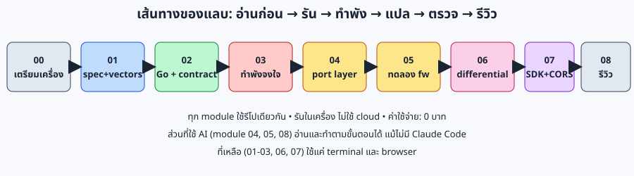
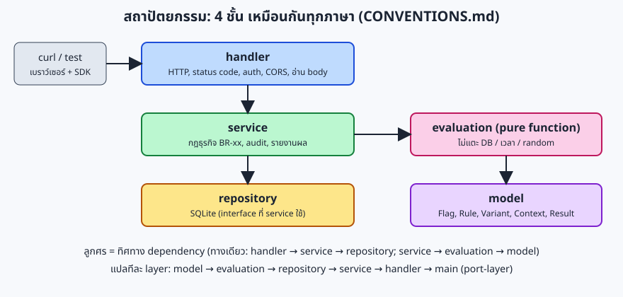
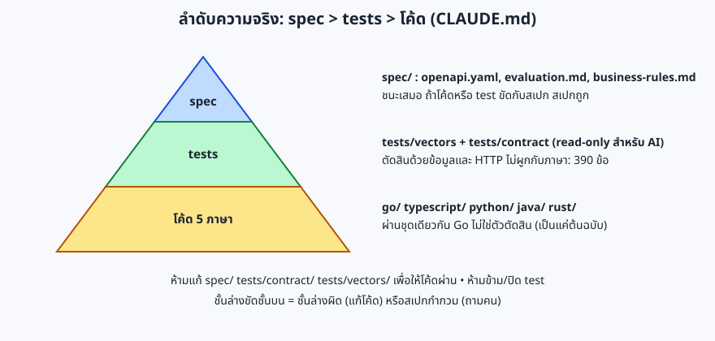

# Lab: สร้างและตรวจซอฟต์แวร์ด้วย AI ทีละขั้น (feature flag service)

แลบลงมือทำสำหรับ **dev, SA และ QA** ที่ต้องการเรียนรู้วิธีให้ AI ช่วยเขียนและแปลโค้ด **โดยมีสเปกและชุดทดสอบเป็นตัวตัดสิน** ไม่ใช่เชื่อ AI หรือเชื่อโค้ดต้นฉบับ โจทย์คือ microservice feature flag (เปิด/ปิด, A/B testing, JS SDK) ที่มีอยู่ในรีโปนี้ครบ 5 ภาษา (Go, TypeScript, Python, Java, Rust)

> **ค่าใช้จ่าย: 0 บาท, รันในเครื่อง** (ไม่ใช้ cloud, ไม่มีบัญชีที่ต้องสมัคร) ส่วนที่เรียกใช้ AI (module 04, 05, 08) อาจใช้โควตาตามแพลนของผู้เรียนเอง แต่ทุก module อ่านและทำตามขั้นตอนได้โดยไม่ต้องมี AI: ส่วนที่เป็น prompt ถูกแยกไว้ในกล่อง "Prompt สำหรับ AI"



## ภาพรวมระบบที่ใช้ในแลบ



ทุกภาษามีโครงสร้างเหมือนกัน (กำหนดใน [`CONVENTIONS.md`](../../CONVENTIONS.md)) สิ่งที่ตัดสินว่าภาษาไหน "ถูก" ไม่ใช่โค้ด Go แต่คือ 3 ชั้นนี้:



## ใครควรทำ

| บทบาท | ได้อะไร | module ที่แนะนำ |
|---|---|---|
| Developer | วิธีแปลทีละ layer, การทดลอง framework ก่อนเขียน handler, mutation check | ทั้งหมด |
| SA / BA | อ่านสเปกแบบ implementer, หาจุดกำกวม, ตัดสินว่าอะไรต้องเขียนลงสเปก | 00, 01, 02, 05, 08 |
| QA / Tester | contract test, ทำให้พังจงใจ (mutation), differential test, ตรวจด้วยเบราว์เซอร์จริง | 00, 01, 02, 03, 06, 07 |

## สิ่งที่ต้องมี

ต้องมี **Node 22+** (ใช้ทุก module) แล้วเลือกภาษาที่จะรันเพิ่ม: **ไม่ต้องลงครบทั้ง 5 ภาษา** ขั้นต่ำที่ทำแลบได้คือ Node + Go; module 04, 05, 06 ใช้ TypeScript และ/หรือ Python เพิ่ม

| เครื่องมือ | เวอร์ชันตาม `CONVENTIONS.md` | เวอร์ชันที่ใช้ตอนเขียนแลบนี้ | ใช้ใน |
|---|---|---|---|
| Node.js | 22 | v22.22.0 | ทุก module |
| Go | 1.22+ | go1.24.7 | 02-08 (service ต้นฉบับ) |
| Python | 3.12+ | 3.13.17 | 05, 06 (ไม่บังคับ) |
| Java / Maven | 21 | OpenJDK 21.0.12.1, Maven 3.9.11 | ไม่บังคับ (ยังไม่ได้รัน gate Java ในแลบ) |
| Rust | stable | cargo 1.97.0 | ไม่บังคับ (ยังไม่ได้รัน gate Rust ในแลบ) |
| Chromium + Playwright | pin 1.63.0 | Chromium ที่ `/opt/pw-browsers` | 07 |
| Claude Code (หรือ AI coding agent อื่น) | — | — | ไม่บังคับ: module 04, 05, 08 |

เวลาโดยประมาณ (ไม่ได้จับเวลากับผู้เรียนจริง: ตัวเลขคือค่าประมาณของผู้เขียน; เวลาที่เครื่องทำงานจริงที่วัดได้ เช่น build Go ~12 วินาที, contract 390 ข้อ ~5 วินาที ระบุไว้ในแต่ละ module)

## ตาราง module

| # | Module | เวลา | ระดับ | เรียนรู้อะไร | ใช้ AI |
|---|---|---|---|---|---|
| 00 | [เตรียมเครื่อง](00-setup.md) | 20 น. | ง่าย | ตรวจเวอร์ชัน, build Go, เปิด/ปิด server ให้ถูกวิธี | ไม่ |
| 01 | [อ่านสเปกและ test vectors](01-spec-and-vectors.md) | 30 น. | ง่าย | อ่าน BR-xx, คำนวณ FNV-1a/bucket ด้วยมือและตรวจกับ vectors | prompt อ่านสเปก |
| 02 | [รัน Go และ contract test](02-run-go-contract.md) | 25 น. | ง่าย | ยิง API จริง, เห็น 390 ข้อผ่าน, อ่านผลตาม BR | ไม่ |
| 03 | [ทำให้พังจงใจ (MOCK_BUG, mutation)](03-break-it.md) | 30 น. | กลาง | test ที่ดีต้อง "ล้มได้" และล้มด้วยเหตุผลเดียว | prompt เขียน test |
| 04 | [แปลหนึ่ง layer ด้วย port-layer](04-port-layer.md) | 45 น. | กลาง | prompt แปล, gate หลังแปล, สิ่งที่ต้องตรวจจากคำตอบ AI | prompt แปล |
| 05 | [ทดลอง framework ก่อนเขียน handler](05-framework-experiments.md) | 30 น. | กลาง | `%FF`, `%2F`, OPTIONS, `/docs` ที่ framework ทำเอง | prompt ทดลอง |
| 06 | [Differential test](06-differential.md) | 20 น. | กลาง | หาความต่างที่ test ไม่เคยเขียน | ไม่ |
| 07 | [JS SDK, CORS และเบราว์เซอร์จริง](07-sdk-cors.md) | 30 น. | กลาง | BR-56/57, preflight, ภาพหน้าจอจริง | ไม่ |
| 08 | [รีวิวอิสระและสิ่งที่ยังเหลือ](08-review.md) | 20 น. | ง่าย | `/review-port` ใน session ใหม่, ข้อจำกัดของแลบนี้ | prompt รีวิว |
| — | [Cheat sheet: ค่าและ prompt ทั้งหมด](cheatsheet.md) | — | — | รวมทุกค่าที่ต้องพิมพ์และทุก prompt ไว้หน้าเดียว | — |

รวมประมาณ 4 ชั่วโมง 15 นาที (แบ่งเป็น 2 รอบได้: 00-03 และ 04-08)

## สิ่งที่แลบนี้ยืนยันแล้วและยังไม่ได้ยืนยัน

ทุกคำสั่งและ "Expected output" ในแลบรันจริงในเครื่องของผู้เขียนแลบ (Linux, ผ่าน proxy ของ sandbox) ถ้าตัวเลขของคุณต่างจากนี้ ให้เชื่อเครื่องของคุณและตรวจสาเหตุ

| รายการ | ผลที่รันจริง |
|---|---|
| `node tools/verify-vectors/verify.mjs` | fnv1a32: 11, bucketing: 300, evaluation: **65**, failures: 0 (ตาราง `tests/vectors/README.md` เขียน 57 แถว: ใช้ตัวเลขจากคำสั่ง) |
| Contract กับ Go, `CORS_ORIGINS=https://app.example.com,https://b.example.com` | **390 / 390** ผ่าน |
| Contract กับ Go, `CORS_ORIGINS=*` / ไม่ตั้ง | **388 / 388** และ **378 / 378** ผ่าน |
| Contract กับ TypeScript และ Python, ไม่ตั้ง `CORS_ORIGINS` | **378 / 378** ผ่านทั้งคู่ (โหมดอื่นของสองภาษานี้ และ Java/Rust ยังไม่ได้รันในแลบนี้) |
| Gate ของ Go: `go vet`, `gofmt`, `go test -count=1 -race ./...` | ผ่านทุก package |
| Gate ของ TypeScript: `npm run lint`, `npm test` | ผ่าน, 176 test |
| Gate ของ Python: `ruff check`, `ruff format --check`, `compileall`, `pytest` | ผ่าน, 347 test |
| SDK: `npm test` ใน `sdk-js/` | 65 test ผ่าน, 1589 ไบต์ gzip |
| MOCK_BUG 9 ชนิด | ทุกชนิดถูกจับ (ดู module 03) |
| Differential Go↔TypeScript, Go↔Python (seed 1, 3000 request) | 0 ความต่างทั้งคู่; Go↔mock ที่ใส่ bug: 26 ความต่าง |
| Browser check (Playwright + Chromium) | `EXPECT=allowed` และ `EXPECT=blocked` ได้ `ok` ทั้งคู่ |
| ส่วนที่เรียกใช้ AI (prompt ใน module 01, 03, 04, 05, 08) | **ยังไม่ได้ทดสอบกับ AI จริง**: prompt เขียนจาก skill ใน `.claude/skills/` และบทเรียนใน `lessons/` ผลลัพธ์ที่เขียนว่า "ตัวอย่างรูปแบบคำตอบ" เป็นรูปแบบที่ skill กำหนด ไม่ใช่คำตอบที่บันทึกจาก AI |
| Gate ของ Java และ Rust, Contract กับ Java/Rust | **ยังไม่ได้ทดสอบในแลบนี้** (รายงานในเอกสาร `lessons/` ว่าผ่าน) |
| `npm ci` ใน `typescript/` และ `sdk-js/`, สร้าง `python/.venv` ใหม่ | **ยังไม่ได้ทดสอบ** (ในเครื่องผู้เขียนมีอยู่แล้ว); `npm ci` ใน `tools/browser-check/` ทดสอบแล้ว |
| ผู้เรียนจริงทำตามแลบ | **ยังไม่ได้ทดสอบ** (เกณฑ์ข้อ 4 ใน `lessons/summary.md` ยังเปิดอยู่) |

## Clean up ทั้งแลบ

ทุก module มีหัวข้อ Clean up ของตัวเอง ถ้าจะล้างทั้งหมดเมื่อจบ:

```bash
ps -ef | grep -E "ffservice|server.mjs|dist/server.js|app.main|http.server" | grep -v grep
```

ถ้ามีโปรเซสที่คุณเปิดค้างไว้ ให้ `kill <PID>` ทีละตัว (ห้าม `pkill`/`killall` เพราะอาจฆ่าโปรเซสของงานอื่น) แล้วลบโฟลเดอร์ชั่วคราว:

```bash
rm -rf "$LAB"
```

แลบนี้ไม่แก้ไฟล์ใดในรีโปนอกจากที่ module 04 บอกชัดเจน (ทำในสำเนา) ไฟล์ที่แลบสร้างในรีโปคือ `docs/lab/` เท่านั้น

## FAQ / Troubleshooting

| อาการ | สาเหตุที่พบบ่อย | แก้ |
|---|---|---|
| contract test ล้มทั้งชุด (300+ ข้อ) | ไม่มี server ที่พอร์ต 8080 หรือชี้ผิดพอร์ต (ลืม `BASE_URL`) | `curl localhost:8080/healthz` ต้องได้ `{"status":"ok"}` ก่อนรัน test |
| `node --test tests/contract/` ไม่รันอะไร | ต้องใช้ glob | ใช้ `"tests/contract/*.test.mjs"` (มีเครื่องหมายคำพูด) |
| จำนวน test ไม่ใช่ 390 | `CORS_ORIGINS` ต่างจากที่ test อ่าน: ไม่ตั้ง = 378, `*` = 388 | ตั้ง env เดียวกันทั้งตอนเปิด server และตอนรัน test |
| `address already in use` | server เก่ายังค้าง | `ps -ef | grep ffservice` แล้ว `kill <PID>` (ห้าม `pkill`) |
| `kill $!` แล้ว server ไม่ตาย | เขียน `cd x && cmd &` ทำให้ `$!` เป็น PID ของ subshell: เกิดจริงตอนเขียนแลบนี้ (ดู module 00) | เขียน `( cd x && exec cmd ) &` |
| ผลของ Go ที่ build ไว้เก่า | build ค้างจากโค้ดก่อนหน้า | build ใหม่ด้วย `go build -o "$LAB/ffservice" ./cmd/server` |
| `ss` ไม่แสดงอะไรทั้งที่ server รันอยู่ | `ss` ใน sandbox นี้ใช้ไม่ได้ (บทเรียน TypeScript) | ใช้ `ps` |
| Playwright หา Chromium ไม่เจอ | ยังไม่ได้ติดตั้งเบราว์เซอร์ | ใน sandbox นี้อยู่ที่ `/opt/pw-browsers`; เครื่องอื่นรัน `npx playwright install chromium` เอง (ยังไม่ได้ทดสอบ) |
| ภาษาไทยในภาพ SVG เป็นสี่เหลี่ยม | เครื่องไม่มีฟอนต์ไทย | ดูใน GitHub หรือเบราว์เซอร์ปกติ |

## ที่มาของเนื้อหา

[`docs/workshop/`](../workshop/README.md) (13 step แบบสร้างทั้งโปรเจกต์), [`lessons/summary.md`](../../lessons/summary.md) (บทเรียนรวม), [`CLAUDE.md`](../../CLAUDE.md) (กติกา AI), [`.claude/skills/`](../../.claude/skills) (port-layer, verify-gates, spec-ambiguity-check, review-port) แลบนี้ต่างจาก workshop ตรงที่ **ไม่สร้างโปรเจกต์ใหม่** แต่ใช้ของที่มีอยู่แล้วเพื่อฝึกแต่ละทักษะแยกกัน
