# Workshop: ให้ AI สร้างและแปลโค้ดอย่างมีขั้นตอน

เรียนรู้การทำงานกับ AI แบบ **step-by-step** โดยใช้ feature flag service เป็นโจทย์: เริ่มจากวางแผนกับ AI → เขียนสเปก → สร้างต้นฉบับ Go → แปลเป็นภาษาอื่น โดยมีสเปกกับชุดทดสอบกลางเป็นตัวตัดสินคุณภาพ

เอกสารมี 2 ระดับ:

| ระดับ | ที่ไหน | ใช้ตอนไหน |
|---|---|---|
| **ภาพรวม** (หน้านี้) | `docs/workshop/README.md` | ดูว่ามี step อะไรบ้าง ทำตามลำดับ 1, 2, 3… ได้อะไรแล้วไปต่ออย่างไร |
| **ละเอียดต่อ step** | `docs/workshop/steps/NN-*.md` | ลงมือทำ: สร้างไฟล์อะไร → รัน prompt ไหน → ตรวจด้วยคำสั่งอะไร → ผิดแล้วดูตรงไหน |

## สถานะของแต่ละ step

- ✅ **ทดสอบแล้ว** คำสั่งตรวจในเอกสารรันได้จริงและให้ผลตามที่เขียน (step 2–11 มีไฟล์เฉลยในรีโปให้เปรียบเทียบ ส่วน step 0–1 เป็นการเตรียมงานและการวางแผน ไม่มีไฟล์เฉลย: เนื้อหา `CLAUDE.md` อยู่ในเอกสาร step 0 เอง และผลของการวางแผนสะท้อนอยู่ใน [`README.md`](../../README.md) ของรีโป)
- ⏳ **ยังไม่มีเฉลย** เอกสารเขียนจากแผนและยังไม่ได้ทดสอบกับโค้ดจริง (ตอนนี้ไม่เหลือ step ใดอยู่ในสถานะนี้ แต่ยังมีสิ่งที่ "ยังไม่ได้ทดสอบ" บางข้อ ดู "สถานะการปิดงาน" ท้ายหน้า)
- ตัวเลขใน step เก่า (เช่น contract 333 ข้อใน step 6 และ 9) เป็นตัวเลข ณ เวลาที่ทำ step นั้น; ตัวเลขปัจจุบันคือ **390 ข้อ** (ดูท้าย step 5)

## ภาพรวม: ทำอะไรตามลำดับ

```mermaid
flowchart LR
    A[0 เตรียมเครื่อง] --> B[1 ขอแผนจาก AI]
    B --> C[2 สเปกกติกา]
    C --> D[3 OpenAPI]
    D --> E[4 Test vectors]
    E --> F[5 Contract tests]
    F --> G[6 Go ต้นฉบับ]
    G --> H[7 สร้าง Skill]
    H --> I[8 วิเคราะห์ก่อนแปล]
    I --> J[9 แปลเป็น TypeScript]
    J --> K[10 Python / Java / Rust]
    K --> L[11 JS SDK]
    L --> M[12 สรุปบทเรียน]
```



| # | Step | คุณทำอะไร | AI ทำอะไร | ได้อะไร (ส่งต่อให้ step ถัดไป) | เวลา | สถานะ |
|---|---|---|---|---|---|---|
| 0 | [เตรียมเครื่อง](steps/00-setup.md) | ติดตั้งเครื่องมือ, สร้างรีโป, เขียนกติกาให้ AI (`CLAUDE.md`) | — | โฟลเดอร์ + `CLAUDE.md` | 15 น. | ✅ |
| 1 | [ขอแผนจาก AI](steps/01-plan-with-ai.md) | ตอบคำถาม, ตัดสินใจ, อนุมัติแผน | ร่างแผน, ระบุความเสี่ยง, ถามคำถาม | `docs/plan.md` | 20 น. | ✅ |
| 2 | [สเปกกติกา](steps/02-spec-rules.md) | ตัดสินใจกติกาทุกข้อ | สัมภาษณ์, เขียนสเปก, หาจุดกำกวม | `spec/evaluation.md`, `spec/business-rules.md` | 45 น. | ✅ |
| 3 | [OpenAPI](steps/03-openapi.md) | รีวิว, รันตัวตรวจ | เขียน `openapi.yaml` | `spec/openapi.yaml` | 20 น. | ✅ |
| 4 | [Test vectors](steps/04-test-vectors.md) | รีวิว, ทำ mutation check | เขียน generator + ตัวตรวจอิสระ | `tests/vectors/*.json` | 40 น. | ✅ |
| 5 | [Contract tests](steps/05-contract-tests.md) | รีวิว, สั่งใส่ bug ทดสอบ | เขียน test + mock server | `tests/contract/` | 45 น. | ✅ |
| 6 | [Go ต้นฉบับ](steps/06-golden-go.md) | อนุมัติทีละ layer | เขียนโค้ด Go จน test ผ่าน | `go/` (golden) | 60–90 น. | ✅ |
| 7 | [สร้าง Skill](steps/07-skills.md) | เขียนกติกาการแปลเป็น skill | — | `.claude/skills/` (4 skill รวม `review-port`), `CLAUDE.md` | 20 น. | ✅ ¹ |
| 8 | [วิเคราะห์ก่อนแปล](steps/08-pre-port-analysis.md) | อนุมัติแผนภาษาปลายทาง | รายงานจุดที่แปลตรงๆ ไม่ได้ | `docs/porting/<lang>-analysis.md` | 20 น. | ✅ (TS, Python, Java, Rust) |
| 9 | [แปลเป็น TypeScript](steps/09-port-typescript.md) | อนุมัติทีละ layer, อ่านโค้ด | แปล, รัน gates, แก้ | `typescript/` | 60 น. | ✅ |
| 10 | [Python / Java / Rust](steps/10-port-other-languages.md) | เหมือน step 9 | เหมือน step 9 | `python/` `java/` `rust/` | 45 น./ภาษา | ✅ |
| 11 | [JS SDK (MVP3)](steps/11-js-sdk.md) | รีวิว API ของ SDK | สร้างจาก OpenAPI | `sdk-js/` | 45 น. | ✅ |
| 12 | [สรุปบทเรียน](steps/12-retrospective.md) | สรุปว่าอะไรได้ผล | ช่วยสรุปจาก log | `lessons/*.md`, prompts ที่ปรับแล้ว | 20 น. | ✅ (ข้อเสนอนำไปใช้แล้ว; **ยังไม่มีคนอื่นลองทำตามเอกสาร**, รีวิวอิสระโดยผู้ใช้กำลังดำเนินการ) |

¹ สร้างและตรวจโครงสร้างแล้ว แต่ยังไม่เคยเรียกผ่าน `/ชื่อ` จริง: session ที่สร้าง skill เรียกมันไม่ได้ ดูหมายเหตุใน step 7 (รวม `review-port` ที่รอผู้ใช้เรียกใน session ใหม่)

## วงจรที่ใช้ซ้ำในทุก step

```
ขอแผน/ร่าง ──▶ คนรีวิว ──▶ รัน prompt ──▶ ตรวจด้วยคำสั่ง ──▶ ผ่าน? ──▶ commit ──▶ step ถัดไป
     ▲                                          │ ไม่ผ่าน
     └──────────── ส่งผลที่ fail กลับให้ AI ◀────┘  (ไม่เกิน 3 รอบ แล้วคนเข้ามาดู)
```

หลักที่ใช้ทุก step:

1. **คนตัดสินใจ AI ลงมือ**: เรื่องกติกาและขอบเขตให้ AI ถามคุณ ไม่ใช่ AI เดา
2. **ทุก step มีคำสั่งตรวจที่รันได้**: ไม่ใช้ความรู้สึกว่า "ดูถูกแล้ว"
3. **สเปกและ test ชนะโค้ดเสมอ**: ห้ามแก้ test หรือสเปกเพื่อให้โค้ดผ่าน
4. **ตรวจ test เอง**: test ที่ไม่เคยเห็นมัน fail คือ test ที่ยังไม่รู้ว่าใช้ได้ (ใส่ bug แล้วดูว่าจับไหม)
5. **commit ทุกครั้งที่ผ่าน**: ย้อนกลับได้ และเห็นว่าแต่ละ step ได้อะไร

## เส้นทางสำหรับผู้สอน

| รูปแบบ | ช่วงเวลา | ทำ step | ผู้สอนเตรียมไว้ให้ก่อน |
|---|---|---|---|
| **A. Spec-first** | 3 ชม. | 1 → 5 | รีโปเปล่า + เครื่องมือติดตั้งแล้ว |
| **B. Port** | 3 ชม. | 7 → 9 + 12 | ผ่าน step 0–6 แล้ว (ใช้ `go/` ของรีโปนี้เป็นต้นฉบับได้เลย) |
| **C. เต็มรูปแบบ** | 2 วัน | 0 → 12 | — |

เช็กลิสต์ก่อนวันสอน:

- [ ] ทุกคนมี Go 1.22+, Node 22+ และ Claude Code (หรือ AI ที่ใช้) ที่ล็อกอินแล้ว
- [ ] ทุกคนรัน `node --version` และ `go version` ผ่าน (step 0)
- [ ] ผู้สอนลองทำ track ที่จะสอนครบจบก่อนหนึ่งรอบ ผล AI ไม่ซ้ำกันทุกครั้ง ต้องรู้ว่าจุดไหนมักพลาด
- [ ] เตรียมแผนสำรองกรณี AI ตอบช้าหรือพลาด: ให้เปิดไฟล์เฉลยในรีโปแล้วเดินต่อ

## ถ้า AI ทำพลาด ทำอย่างไร

| อาการ | ทำอะไร |
|---|---|
| ผลไม่ตรงที่คาด แต่ไม่รู้ว่าใครผิด | เทียบกับสเปกก่อน ถ้าสเปกไม่ชัด **แก้สเปก** แล้วค่อยแก้โค้ด |
| test fail วนเกิน 3 รอบ | หยุด อ่าน test ที่ fail ด้วยตัวเอง แล้วบอก AI ว่าผิดที่ไหน อย่าให้เดาต่อ |
| AI เสนอให้แก้/ข้าม test | ปฏิเสธ แล้วถามว่า "สเปกข้อไหนที่ทำให้ test นี้ผิด" |
| โค้ดผ่านทุก test แต่อ่านแล้วแปลก | ให้ AI อธิบายทีละบรรทัด หรือให้ refactor แล้วรัน test ซ้ำ |

## ไฟล์อ้างอิงในรีโป

| ต้องการ | ดูที่ |
|---|---|
| ภาพรวมโปรเจกต์ | [`README.md`](../../README.md) |
| กติกาและ library ต่อภาษา | [`CONVENTIONS.md`](../../CONVENTIONS.md) |
| เฉลย step 2–3 | [`spec/`](../../spec) |
| เฉลย step 4 | [`tests/vectors/`](../../tests/vectors/README.md), [`tools/genvectors/`](../../tools/genvectors), [`tools/verify-vectors/`](../../tools/verify-vectors) |
| เฉลย step 5 | [`tests/contract/`](../../tests/contract/README.md), [`tools/mock-server/`](../../tools/mock-server) |
| เฉลย step 6 | [`go/`](../../go/README.md) |
| เฉลย step 7 | [`CLAUDE.md`](../../CLAUDE.md), [`.claude/skills/`](../../.claude/skills) |
| เฉลย step 8 | [`docs/porting/typescript-analysis.md`](../porting/typescript-analysis.md) |
| เฉลย step 10 | [`python/`](../../python/README.md), [`java/`](../../java/README.md), [`rust/`](../../rust/README.md), [`lessons/python.md`](../../lessons/python.md) [`java.md`](../../lessons/java.md) [`rust.md`](../../lessons/rust.md) [`comparison.md`](../../lessons/comparison.md), [`docs/porting/`](../porting) |
| เฉลย step 11 | [`sdk-js/`](../../sdk-js/README.md), [`lessons/sdk-js.md`](../../lessons/sdk-js.md) |
| เฉลย CORS (BR-56/57) + gate เบราว์เซอร์ | [`spec/business-rules.md`](../../spec/business-rules.md), [`tests/contract/cors.test.mjs`](../../tests/contract/cors.test.mjs), [`tools/browser-check/`](../../tools/browser-check/README.md), ท้ายไฟล์ [`docs/porting/*-analysis.md`](../porting) |
| แล็บฝึกหัด | [`docs/lab/README.md`](../lab/README.md) |
| เฉลย step 9 | [`typescript/`](../../typescript/README.md), [`lessons/typescript.md`](../../lessons/typescript.md), [`tools/diff-servers/`](../../tools/diff-servers/diff.mjs), [`tools/mutation-check/`](../../tools/mutation-check/ts.sh) |

## สถานะการปิดงาน

ปิดงานส่วนที่ทำได้โดยไม่ต้องพึ่งคนอื่นแล้ว (ณ 2026-10-31) ส่วนที่เหลือระบุตรงๆ ด้านล่าง ไม่ถือว่า "เสร็จสมบูรณ์" จนกว่าข้อ "ยังเปิด" ปิดครบ ตาม `CLAUDE.md` ("ก่อนเรียกงานใหญ่ว่าเสร็จ ต้องมีรีวิวโดย session อื่น")

**ทำแล้ว**

- สเปก (กฎ BR-xx ถึง BR-57), test vectors (65 แถว + erfc), contract test **390 ข้อ** (`CORS_ORIGINS=https://app.example.com,https://b.example.com`; 388 เมื่อ `*`; 378 เมื่อไม่ตั้ง)
- implementation 5 ภาษา (Go, TypeScript, Python, Java, Rust) + JS SDK: build, lint, unit test ผ่านทุกภาษา
- differential test (Go เทียบแต่ละภาษาที่เหลือ, seed 1 และ 2, ภาษาละ 3,000 คำขอ): 0 ความต่าง
- `tools/browser-check` (Playwright + Chromium จริง + bundle SDK): ผ่านทั้ง 6 server (mock + 5 ภาษา)
- เอกสาร: ทุก step (0–12), `docs/porting/*-analysis.md` (พร้อมที่ตั้งของ CORS/BR-57 ในแต่ละภาษา), `lessons/*`
- รีวิวโดย agent ใหม่ 1 รอบ (โมเดลเดียวกัน): แก้แล้วทุกข้อ (test CORS เพิ่ม, `Origin:` ว่าง, BR-57)

**ยังเปิด**

| เรื่อง | สถานะ |
|---|---|
| รีวิวอิสระใน session ใหม่ (`/review-port`) | **เสร็จแล้ว ไม่มีข้อที่ต้องแก้** (ผู้ใช้แจ้ง; รายงานไม่ได้เก็บไว้ในรีโป) |
| กรณี 5xx ของ CORS (BR-56 "ทุกสถานะ") | ทดสอบจากภายนอกไม่ได้ (บังคับให้ server ตอบ 500 ไม่ได้) มีเฉพาะ unit test ต่อภาษา |
| ผู้เขียนกับผู้รีวิวรอบแรกเป็นโมเดลเดียวกัน | ข้อสรุปทั้งหมดจึงมีอคติร่วมที่ตรวจไม่ได้ |
| เกณฑ์ข้อ 4 ของ step 12 (dev คนอื่นทำตามเอกสารแล้วถึงผลเดียวกัน) | ยังไม่ได้ทดสอบ |
| skill ยังไม่เคยถูกเรียกผ่าน `/ชื่อ` ใน session ใหม่ | `port-layer`, `verify-gates`, `spec-ambiguity-check`, `review-port` |
| เวลาที่ใช้ต่อ step/ภาษา | ไม่ได้บันทึก จึงเทียบ "คุ้มต่อเวลา" ไม่ได้ |
| ชื่อ/รูปแบบ env `CORS_ORIGINS`, dependency ที่ framework พ่วงมา (tokio, serde_json, http-body-util ฯลฯ) | เป็นข้อสมมติของเรา ระบุไว้ใน `CONVENTIONS.md` และ `docs/porting/` |
| `Makefile`, `prompts/`, สไลด์ workshop, license | ยังไม่มี (Makefile อยู่ในแผนของ `CONVENTIONS.md`) |

**รันทุก gate ซ้ำได้อย่างไร**

คำสั่งทั้งหมดอยู่ใน [`CONVENTIONS.md`](../../CONVENTIONS.md) ไม่ซ้ำที่นี่:

1. ต่อภาษา: ตาราง "คำสั่ง gate ต่อภาษา" (build, lint/format, unit test รวม vectors) ในโฟลเดอร์ของภาษานั้น
2. contract test: หัวข้อ "Contract test" ใน `CONVENTIONS.md` (ตั้ง `CORS_ORIGINS` สองค่า ตามที่ระบุ แล้วลองอีกสองโหมดคือ `*` และไม่ตั้ง; เปิด server ด้วย `( cd dir && exec คำสั่ง ) &`, ตรวจ `/healthz`, ปิดด้วย PID, ตรวจด้วย `ps`)
3. SDK: ตาราง "SDK ฝั่ง web" ใน `CONVENTIONS.md`
4. vectors: `node tools/verify-vectors/verify.mjs`
5. differential: `node tools/diff-servers/diff.mjs <urlA> <urlB> --seed=1` (และ `--seed=2`) ดูหัวไฟล์ [`tools/diff-servers/diff.mjs`](../../tools/diff-servers/diff.mjs)
6. mutation: สคริปต์ใน [`tools/mutation-check/`](../../tools/mutation-check) (`ts.sh`, `py.sh`, `java.sh`, `rust.sh`, `sdk.sh`) ใส่ bug ทีละจุดในสำเนาของโค้ด (วิธีเรียกอยู่หัวไฟล์ แต่ละสคริปต์; รายการ mutation ที่เคยใช้อยู่ใน `lessons/*.md` และตารางใน [`tests/contract/README.md`](../../tests/contract/README.md)) — ไม่ใช่คำสั่งเดียวรันครบ
7. เบราว์เซอร์: [`tools/browser-check/README.md`](../../tools/browser-check/README.md)
8. สั่งรวมต่อภาษาด้วย skill `/verify-gates <ภาษา>`; รีวิวอิสระด้วย `/review-port <ภาษา>` ใน session ใหม่
